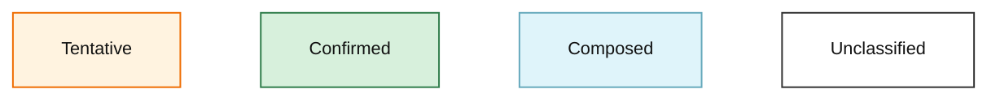

<!-- ARTIFACTS.md -->

# Destek ISA network card artifacts

## Provenance

The historical inputs for this analysis came from the Internet Archive item
[`destek-isa-network-card`](https://archive.org/download/destek-isa-network-card).
This report identifies the exact local inputs used for the analysis; it does
not modify either binary image.

## Recovered Destek host requirements

The option ROM uses fixed host RAM addresses rather than allocating its
workspace from the BIOS memory size. *Table Host RAM requirements* records
the resulting memory requirements. These addresses require at least
128 KiB of contiguous conventional RAM, not a fully populated 640 KiB
machine. Native 8088 validation used 512 KiB; a 128 KiB configuration has
not been tested. The complete layout is in the
[boot memory map](boot/BootMemoryMap.md).

*Table Host RAM requirements*

| Physical range (hex) | Purpose | Requirement |
| --- | --- | --- |
| 0a000-0af9f | Saved loading screen | 4,000 bytes of host RAM while the downloaded menu is displayed |
| 1fa00-1fd0e | Runtime workspace | Fixed transport state and copied tables |
| 1fe00-1feff | Initial ROM stack | Writable RAM below the initial stack top at 1ff00h |

`CopyTextScreen` at CAFF copies between caller-supplied segments.
`WriteFunctionKeyMenu` calls it at CA28 with destination `0a00h` and
source `DisplaySegment`. After a valid selection, `PollKeyboard` calls
it at CAE9 with those arguments reversed, restoring the loading screen.
There is no separate restore subroutine: the same copy routine implements
both operations. Segment `0a00h` addresses physical `0a000h`, not the
adapter window at `a0000h`.

## Inputs and outputs

The [native 8088 validation](boot/Validation.md)
records a completed 256-byte introduction plus 20 KiB image download and
both executed Hello forms. The [distribution notes](boot/BootstrapDistribution.md)
describe separately assembled fragments and CMD composition.

### CRC table anomaly

The table at file offset 179fh has one entry inconsistent with reflected
CRC-16 polynomial a001h: index a4h at file offset 18e7h (listing D8E7)
is b801h instead of bb01h. This is not merely a disassembly annotation:
an intact long receive frame failed validation because a standard host
CRC differed from the ROM's calculation. Using the ROM's actual table
allowed the complete transfer without modifying the EPROM image.

A transcription typo while copying a printed table roughly 40 years ago
is plausible. The discrepancy and its behavior are established; whether
it was present in the original source or arose later is not established
by this single image. This finding belongs to the recovered protocol,
not to an emulator timing workaround.

### Conditional escaping

Literal aah is unquoted when the next octet is below f0h.
At CE8F, transmitting aah changes the look-ahead threshold
to efh; CE24 inserts ffh only if the next byte exceeds that threshold.
The CDC1 receive path first retains literal aah, then processes the low
following byte. The host parser now follows this behavior. The
[protocol specification](boot/SerialBootstrapProtocol.md) records all cases.

### Artifact inventory

| Artifact | Role | Size | SHA-256 |
| --- | --- | ---: | --- |
| `5150 Option ROM.bin` | Original IBM PC option ROM image | 8,192 bytes | `BB1AD6A65F5911F8EFBEC8FD6CC916495ADC1C024FB036B7AEBE3F0287311666` |
| `Destek MON100.BIN` | Original on-card monitor ROM image | 4,096 bytes | `664AC9496BB025EAD9DFE5715A7F7EC53928AC75D737C0BCE01C7D0ED093FB82` |
| `5150 Option ROM.asm` | Annotated 8086-family disassembly of the option ROM | Text listing | Generated from `5150 Option ROM.bin` |
| `5150 Option ROM.sym` | Plain-text symbol and data-range table for the option ROM | Text symbols | Input to the annotation pass |
| `5150 Option ROM.r2` | Radare2 text analysis script for the option ROM | Text script | Directs code/data classification and names |
| `OptionRom.inc` | Recovered MASM-compatible macros and equates | Text include | Used by the annotated option-ROM listing |
| `Pc5150Hardware.inc` | Shared IBM PC/5150 port, BIOS, and display constants | Text include | Included by `OptionRom.inc` |
| `OptionRomInitialization.inc` | Absolute segments needed only during option-ROM startup | Text include | Included by `OptionRom.inc` |
| `OptionRomUtilities.inc` | Shared `Message` descriptor macro | Text include | Included by `OptionRom.inc` |
| `source/OptionRomLayout.asm` | Source-composition wrapper | MASM source | Orders definitions and fragments for the consolidated listing |
| `OptionRomEntryFragment.inc` | ROM entry and relocation range | Source fragment | Included at `0049h` |
| `OptionRomInterruptUtilities.inc` | Interrupt-vector utility range | Source fragment | Included at `00e8h` |
| `OptionRomSerialCallbacks.inc` | Serial callback range | Source fragment | Included at `0622h` |
| `OptionRomDisplayUtilities.inc` | Display initialisation and output ranges | Source fragment | Included at `0951h` |
| `OptionRomPcNetRuntimeTemplate.inc` | PC-NET static template and CRC table | Source fragment | Included at `1689h` |
| `OptionRomMemoryMap.inc` | Absolute-ROM module location macros | Text include | Shared by separately assembled modules |
| `OptionRomMemoryMap.md` | Non-overlapping module range map | Documentation | Defines fixed ROM placement |
| `OptionRomInterruptUtilities.asm` | Recovered interrupt-vector utility module | MASM source | Absolute range `00e8h-013ah` |
| `boot/Bootstrap-server.ps1` | Serial bootstrap peer | PowerShell script | Frames, captures, and logs COM1 traffic |
| `boot/RomCrc16.txt` | Distributable wire CRC profile | Text table | All 256 words from ROM offset `179fh`, including entry `a4h=b801h` |
| `testing/boot/Start-86Box.ps1` | Automatic emulator launcher | PowerShell script | Starts the host and native 8088/MDA emulator without interactive input |
| `boot/README.md` | Serial bootstrap workflow | Documentation | Describes composition, serial sending, and replay; links to 86Box validation |
| `Card ROM.asm` | Supplied Z80 disassembly of `Destek MON100.BIN` | 3,531 lines | Pre-existing artifact |

## `5150 Option ROM.bin`

This is an IBM PC option ROM. `OptionRomSignature` is `55 AA`,
`OptionRomSizeBlocks` is `10h`, declaring 16 512-byte blocks and therefore an
8 KiB image, and the initial short jump transfers from offset `0003h` to
`0049h`. `OptionRomChecksum` completes the image checksum: the sum of all
8,192 bytes is `00h` modulo 256. Thus executable code begins at
`C000:0049` (physical `c0049h`, shown by objdump as `c049`).
The header data at offsets `0020h` through `0048h` contains the visible string
`MAGIX COPR. SABAKI ENTERPRISES, INC. 1985`. It is exposed in the MASM source
as the `ManufacturerString` ASCII data definition.

### Reset entry

`RomResetEntry` at listing dff0h is file offset 1ff0h. With the 8 KiB
image fitted at physical fe000h, this is the processor's reset address
ffff0h. Its far jump to `fe00:0049` enters the same ROM's main entry.
The [Intel 8086 family manual](https://www.inf.pucrs.br/~calazans/undergrad/orgcomp_EC/mat_microproc/intel-8086_family_Users_Manual.pdf)
defines the reset entry address. This is executable reset-vector code,
not unused data or a call into an unidentified external application.

`InitializeDisplay` and `RestoreBiosAndTransferControl` test CS for fe00h.
The reset placement selects direct MDA programming and bypasses restoration
of a preceding BIOS environment. The validated adapter placement at c8000h
instead uses the IBM BIOS's option-ROM entry and BIOS-backed handoff.
The reset placement has not been tested. In particular, the BIOS-dependent
Hello sample is validated only with the BIOS present.

### Reassembly status

Microsoft MASM 14.42.34438.0 assembles the self-contained `5150 Option ROM.asm` into a
bit-identical 8,192-byte ROM. The [strict ROM build](testing/rom/README.md)
checks every byte and the SHA256 before publishing `OptionRom.bin`.
The original ROM remains unchanged and is still the emulator input.

`RepneMovsb` preserves the original `f2 a4` instruction bytes. MASM
14.42 rejects `repne` on `movsb`, so the macro emits the `f2` prefix
explicitly before the instruction. On the 8088 this repeats the copy
according to CX, without testing ZF. Using the accepted `rep movsb`
spelling would emit `f3 a4` and break byte identity. `RepneMovsw` and
`RepneStosb` preserve the same prefix in their respective instructions.

The reconstructed listing preserves the original instruction encodings; the
strict build compares every emitted byte with the original ROM.

`source/OptionRomInterruptUtilities.asm` and
`source/OptionRomMemoryMap.inc` preserve the independent-module experiment.
They do not participate in the current build and must not be combined with
the consolidated listing, which already defines those bytes and symbols.

Within this one MASM translation unit, a label or `equ` symbol may not be
defined twice, even with the same value. Fragments therefore share the
definition includes and declare only dependencies. A separately assembled
fragment wrapper may use `extrn` and `public`, but those declarations do not
belong in the composed source unless they are needed for the final assembly.

The source declares `OptionRom SEGMENT AT 0C000h`, matching the IBM 5150
option-ROM socket mapping. The disassembler's `Cxxxh` and `Dxxxh` headings are
linear display addresses formed from `C000h` plus the ROM offset: listing
`cc00h` is therefore `C000:0c00` (physical `c0c00h`), not `CC00:0000`.
Direct ROM references can be fixed up to labels without changing their encoded
targets. `PcNetDriverInterface
SEGMENT AT 0CC00h`, followed by `org 0003h`, declares the far IBM PC-NET entry
as `PcNetDriverEntry` (`CC00:0003`). This is a non-emitting foreign-interface
declaration, not a code segment reconstructed from this image: the PC-NET
implementation bytes are absent from the supplied `C000h` ROM. `SelectIBMPcNet`
verifies the segment through IVT vector `5Ch` before the far call uses that
absolute symbol. `CC00:0003` is physical `cc003h` in the external PC-NET ROM.

Every direct intra-ROM call, jump, conditional branch, and loop target without
a descriptive symbol is given an `Lxxxx` label in `5150 Option ROM.sym` and
the annotated listing. These deliberately neutral labels mark analysis
frontiers without asserting a procedure name.

Load the binary with the Radare2 script using:

```powershell
r2 -a x86 -b 16 -m 0xc000 -i '5150 Option ROM.r2' '5150 Option ROM.bin'
```

## Display subroutines

| Symbol | ROM offset | Responsibility |
| --- | ---: | --- |
| `OptionRomEntry` | `0049h` | Saves the caller context, installs the ROM environment, displays the version and loading messages, then enters hardware initialization. |
| `SelectTransport` | `024Ah` | Probes the enabled transports, retains the selected callback set, unmasks its interrupt, and returns to entry initialization. |
| `Display` | `09EEh` | Reads a descriptor in `DS:SI` and writes each character plus its attribute byte to the active text-mode video segment. |
| `ClearScreen` | `09CCh` | Fills the 80x25 text buffer with `20h` and attribute `07h`. |
| `InitializeDisplay` | `0951h` | Configures the display adapter, using BIOS `INT 10h` with `AH=00h` and `AL=03h` for the non-MDA path, then clears the selected text buffer. |
| `SegmentedToLinear` | `03D0h` | Tail-entered helper within `TestIBMPcNet`; converts `AX:BX` to a 20-bit physical address at `DS:SI+6`. |
| `ShowNoNetworkFound` | `0279h` | Displays the network-not-found error and remains in place. |
| `TestLocalAreaNetwork` | `0281h` | Probes the local-area-network adapter, then announces and configures it when present. |
| `TestIBMPcNet` | `034Eh` | Probes IBM PC-NET, then announces and configures it when present. |
| `TestEagleUsart` | `03EAh` | Probes the Eagle USART, then announces and configures it when present. |
| `TestIBMUart` | `04CDh` | Probes the IBM UART, then announces and configures it when present. `TestUart1` writes its four register/value initialization pairs. |
| `InitializeSerialTransport` | `045Bh` | Installs the shared serial runtime state, output callback, and step/restart callbacks used by the Eagle USART and IBM UART paths. |
| `WriteAdapterBytes` | `0F99h` | Writes `CX` bytes from `DS:SI` to the selected adapter, polling status bit 6 before each byte. `AdapterIoSettleDelay` is its shared one-byte return entry, used by receive paths as a short I/O delay. |
| `ReadAdapterBytes` | `0FAAh` | Reads `CX` bytes from the selected adapter into `ES:DI`, polling status bit 6 before each byte. |
| `DrainAdapterBytes` | `0FC0h` | Reads and discards `CX` bytes from the selected adapter while polling status bit 6. |
| `ReadLocalAreaNetworkStatus` | `10CCh` | Reads and normalizes Local Area Network status bits, returning its result in flags. |
| `ShowLanBoardFailed`, `ShowTimeOut`, `ShowBadInterrupt`, `ShowDuplicateAddr`, `ShowCheckServer` | Various | Select an error descriptor and transfer through `DisplayAndReset`. |
| `ShowAddress` | `0809h` | Displays the `ADDRESS:` field and then appends the runtime address value. |
| `InitializeTiganLan` | `0B34h` | Announces and configures Tigan LAN after its preceding probe succeeds. |
| `DisplayAndReset` | `0A0Dh` | Displays the descriptor already in `SI`, delays, then transfers to the reset vector. |

## Runtime data and display hardware

`OptionRomData` is the runtime workspace selected through `DS`. Its
`DisplaySegment` word at offset `002Ah` is established from `ES` after display
initialization and holds either `B000h` (monochrome) or `B800h` (colour text).
`Display` and the address-rendering code load it into `ES` before writing text.
`ActiveTextBuffer` is the MASM lexical segment abstraction used after those
loads; it represents either runtime-selected text buffer rather than asserting
that the active hardware is always monochrome.

`MonoCrtcRegisterValues` at `C9DEh` is the 16-byte value table for CRTC
registers 0 through 15. `InitializeDisplay` uses all sixteen values when it
programs the monochrome CRTC. Its final two values, named by
`MonoCrtcCursorLocation` at `C9EAh`, are reused for CRTC registers 14 and 15
in the colour-text initialization path. The apparent instructions at `C9DEh`
were linear disassembly through this table, not executable code.
`OptionRom.inc` defines `OptionRomData` as the absolute runtime segment at
`1fa0h`; its `DisplaySegment dw ?` declaration owns the word written by the
`pop word ptr DisplaySegment` instruction at `c096h`.

`TransportState` at `DS:004fh` has transport-specific interpretations,
shown in *Table Transport state byte*. All code uses this one generic
name; selecting a transport determines the interpretation.

*Table Transport state byte*

| Transport | Interpretation | Evidence |
| --- | --- | --- |
| Serial | Output-state index; zero is idle | CD12 doubles the index to select SerialOutputStateDispatchOffsets; CF86 starts at state 1 and CEB3 returns to zero |
| PC-NET | Receive and transmit service flags | Bit 3 marks receive processing; bit 4 blocks output until completion; bit 5 requests a flush; bit 6 marks command service; bit 7 defers adapter programming |
| Tigan | Service flags | Bit 7 marks outstanding output and clears on the 2000h completion event; bit 6 brackets receive-queue processing; zero reports readiness |

PC-NET bit 2 additionally requests capture of the 16 bytes copied at D1AB.
The purpose of those bytes remains separate from the established flag
operation. The serial index and adapter masks must not be treated as a
single shared bit layout.

The low workspace fields in *Table Bootstrap workspace fields* have
names based on their readers and writers. Timer values count IRQ0 ticks,
not milliseconds. The low words at 0012h-0016h remain unnamed because
serial treats them as stream pointers while Tigan uses an adapter segment
and pending-queue links; a single narrower name would misdescribe one use.

*Table Bootstrap workspace fields*

| Offset (hex) | Name | Purpose |
| --- | --- | --- |
| 0026 | RemainingImageBlocks | Count loaded from image control, decremented for each accepted TRANSFER block |
| 0028 | ReceiveSlotIndex | Selects the destination slot; also advances between menu halves |
| 002e | BootTimeoutTicks | General progress watchdog, reloaded on receive-buffer acquisition and keyboard polling |
| 0032 | SavedReceivePrefixLow | Saved first word preceding the destination payload |
| 0034 | SavedReceivePrefixHigh | Saved second word preceding the destination payload |
| 0047 | DelayedAckTicks | Countdown before an ACK is queued |
| 0048 | DataRetryTicks | Countdown before retrying outstanding data |
| 0049 | ControlRetryTicks | Countdown before repeating a control exchange |
| 004a | RetryTimeoutBudget | Remaining retry expiries before TIME OUT; reset to ten by an admitted session header |
| 0053 | PendingControlClass | Highest-priority pending control class; six requests completion |
| 0059 | StartupControlClass | Startup announcement class, cleared when START establishes the session |
| 005b | DataRetryInterval | Transport-selected reload value for DataRetryTicks |
| 005c | ControlRetryInterval | Transport-selected reload value for ControlRetryTicks |
| 005d | AckDelayInterval | Transport-selected reload value for DelayedAckTicks |
| 005e | SessionFlags | Enables output, marks outstanding data and defers request advancement |

### Referenced-offset audit

The listing was audited for immediate constants loaded into address registers
and for direct effective addresses. Confirmed ROM targets are represented by
symbols: the CRTC value table at `C9DEh`, the IBM UART initialization pairs at
`C53Bh`, the Eagle USART initialization bytes at `C4B5h`, the PC-NET runtime
template, the CRC table, message descriptors, and the local-area setup payload.
The latter is `LocalAreaNetworkInitializationPayload`, a 19-byte range starting
at the header's node-address byte (`C007h`) which `TestLocalAreaNetwork` sends
unchanged to its adapter.

Not every numeric offset identifies static ROM data. `WriteFunctionKeyMenu`
loads `DS` with `0800h` before using `SI=00DCh`; it reads eight 30-byte menu
strings from `0800:00DCh`, an external/runtime address outside this C000h ROM.
Similarly, its `DI=0CB4h` is a destination in the active display segment.
Those are deliberately documented as runtime addresses rather than invented
ROM tables. The audit therefore distinguishes a proven ROM-data reference from
a segment-relative workspace or device-memory offset.

The audit also found literal code entries in the shared state machine. They are
now labelled `LC67E` and `LC72C` and referenced symbolically; neither is data.

`CompleteDisplayInitialization` at `C9C5h` is a callable tail entry in the
display utility. It clears the text screen, restores the CRTC control value,
and returns. It is distinct from the preceding CRTC register-programming loop.

`ConfiguredNodeAddress` at `DS:00FDh` receives the header node-address word
at the beginning of `SelectTransport`; each selected transport copies it to
the active `NodeAddress` field at `DS:002Ch`. `TransportIrqMask` at
`DS:005Ah` accumulates the PIC IRQ bit required by a successful transport.
`Select1` complements that value and clears the corresponding bits in the
Intel 8259A mask register, enabling only the selected transport IRQs.

`SelectTransport` tries the local-area adapter, `TestTiganLan`,
`SelectIBMPcNet`, the Eagle USART, and the IBM UART in that order.
`TestTiganLan` probes the Tigan LAN register bank. `SelectIBMPcNet` instead
checks interrupt-vector-table entry `5Ch` for the PC-NET service entry at
`cc00:0003`; it then installs PC-NET's step and restart callbacks. It does not
perform a cold hardware initialisation of PC-NET.

The instruction displayed as `cc00h` in this ROM is `C000:0c00`, within the
fall-through continuation of `InitializeTiganLan`, not the external PC-NET
entry. It stores part of the Tigan adapter-RAM control structure after the
preceding copy has established the queue header at `a000:fee6`. The `LCC00`
label was not referenced and is removed; it was a linear-disassembler split,
not a control-flow destination.

All successful transports share the runtime call sites at
`TransportOutputCallback`, `TransportStepCallback`, and
`TransportRestartCallback`. This is a small vtable-like contract: each
transport provides different targets but the state machine always calls the
same workspace slots. The serial paths additionally use the separate
`SerialInterruptDispatchTable` at `DS:0000h` to dispatch UART interrupt causes;
that table is not shared with the LAN transports.

The differing setup styles reflect different hardware contracts rather than an
incomplete common initialiser. The IBM UART uses four COM1 register/value
pairs, the Eagle USART consumes a longer card-specific byte script, and the
local-area and Tigan adapters use direct register sequences. PC-NET is handled
differently again: the ROM binds to a pre-existing PC-NET service entry. The
hardware assignments are grouped in `Pc5150Hardware.inc` for the mainboard and
`OptionRomAdapterHardware.inc` for add-in cards.

`ProgramIbmPcNetAdapter` (`d409h-d44ch`) emits the seven bytes at
`PcNetRuntimeAdapterCommand` (`DS:0094h`) to the selected PC-NET data port.
It then consumes `PcNetRuntimeAdapterConfiguration` (`DS:00a2h`) and its
following register/value pairs. `PcNetRuntimeBufferDescriptor0` (`00b4h`) and
`PcNetRuntimeBufferDescriptor1` (`00c6h`) are the two runtime descriptors
whose segment:offset fields are converted by `SegmentedToLinear`.

`LocalAreaNetworkRestartHandler` at `d0d6h-d11eh` is reached through the
`LocalAreaNetworkRestart` trampoline installed by `TestLocalAreaNetwork`.
It writes the frame header and optional record, then resumes session
processing. The earlier claim that it had no in-ROM reference was wrong.

`TimerInterruptHandler` is the ROM's timer service routine. `InstallInterruptVectors`
places it at interrupt `20h` after remapping the Intel 8259A; the PIC receives
IRQ0 from the Intel 8253 PIT channel 0. The handler decrements operation and
global timeout counters, invokes the shared state machine when a timer expires,
and reprograms channel 0 before returning. Thus its trigger is the PIT through
IRQ0, not a software `int 20h` call.

`RomNodeAddress` is the per-EPROM configuration byte at fixed ROM offset
`0007h` (`c007h` physical in this image). `LC24A` reads it through `CS` into
the runtime node-address field before any transport probe. The preceding byte,
`RomConfigurationFlags` at offset `0006h`, selects the local-area, PC-NET, and
Tigan paths through its tested bits; it is not part of the node address. The
node-address byte is a deliberate fixed production-programming location, not a
relocatable table; the source now renders the header bytes as named definitions
so that it is visible to readers as well as firmware. `FunctionKeyEnableMask`
at offset `001fh` gates the function-key choices in `WriteFunctionKeyMenu`.
The bytes at `0008h-001eh` remain vendor-reserved/unknown rather than being
assigned a speculative PC option-ROM meaning.

`SetInt0OffsetFromRomConfiguration` at `c7c5h` is a terminal path from
`ProcessReceivedBuffer`, not a normal interrupt-vector installation routine.
It sets `ES` to the interrupt vector table and writes the word formed from
`RomNodeAddress` and `RomConfigurationFlags` to `Int0Vector` (`0000:0000`).
Only the vector's offset word changes; its segment word at `0000:0002` is left
untouched. The purpose remains unconfirmed, but the source now makes that
limited write explicit. `AdvanceTransportSession` at `c7dbh` is separately
entered by the receive path and state machine; it advances runtime counters
and requests the next transport session.

The same segment maps the PC-NET runtime stash copied by
`RelocatePcNetRuntimeStash` (`c077h-c092h`). Its source is the absolute alias
`PcNetRelocationSource` at `c169h`; `si` selects
`PcNetRelocationPayload`, `cx` receives `PcNetRelocationPayloadLength`, and
`repne movsb` copies `030fh` bytes to `OptionRomData:0000h`. The destination
definition identifies the copied CRC range as `PcNetRuntimeCrc16Table` at
offset `010fh` and its end at `030fh`.

IBM's [PC Network Technical Reference](https://bitsavers.computerhistory.org/pdf/ibm/pc/pc_network/6322916_PC_Network_Technical_Reference_Sep84.pdf)
describes the adapter's own RAM as scratch, stack, protocol-control, and
transient-buffer storage. It does not establish a field map for this ROM's
`1fa0h` host-memory template. The unnamed runtime fields consequently retain
neutral offset-based labels until their behaviour supports a semantic name.

`assume` is a MASM assembly-time statement. It emits no bytes and does not
define a segment. It tells MASM which segment register following source uses,
so names such as `DisplaySegment` need no explicit segment prefix. The initial
`assume cs:OptionRom, ds:OptionRom, es:nothing, ss:nothing` belongs beside the
entry code. It is lexical and source ordered; segment declarations contain no
`assume` statements.
`NodeAddress` at offset `002Ch` is copied from detected adapter state, rendered
by `ShowAddress`, and included in adapter data structures; it is therefore the
node address.

`InitializeDisplay` now names the hardware decisions explicitly:
`InitializeBiosTextMode` selects BIOS text mode `03h`,
`SelectTextVideoSegment` chooses the monochrome or colour text segment from
the BIOS data area, and `ProgramCrtcRegisters` programs the CRT controller.
The monochrome mode-control and CRT controller ports are defined in
`OptionRom.inc`.

The block at `C0E8h` clears `DS` and writes the IBM PC interrupt vector table,
not a private jump table. `InterruptVectorTable` models the absolute segment at
`0000h`; the ROM installs `TimerInterruptHandler`, `SharedNetworkInterruptHandler`,
`LocalAreaNetworkInterruptHandler`, `IbmUartInterruptHandler`, and `EagleUsartInterruptHandler` into vectors `20h`,
`22h`, `23h`, `24h`, `25h`, and `27h`. The shared `LocalAreaNetworkInterruptHandler` is
deliberate: both vector entries receive the same `C5E6h` offset and `CS`.

`InstallInterruptVectors` also programs the Intel 8259A programmable interrupt
controller (PIC), the chip responsible for prioritising PC hardware interrupt
requests. Its `13h`, `20h`, `0fh`, and `feh` writes initialise the vector base
and interrupt mask after the ROM has installed the corresponding vector-table
entries.

BIOS services abstract the hardware operations they implement; they do not
intercept arbitrary port I/O by an application or option ROM. The
[IBM BIOS listing](https://github.com/philspil66/IBM-PC-BIOS/blob/main/PCBIOS.ASM)
shows BIOS-owned interrupt-controller initialisation. This ROM replaces
that setup with its own handlers and direct UART/PIC I/O, so it is acting
as a hardware driver rather than a BIOS client during downloading.

The ROM's ICW1 value `13h` selects a single controller and omits ICW3;
ICW2 selects vectors `20h-27h`, and ICW4 `0fh` enables automatic EOI.
A cascaded controller configuration requires ICW3 to describe the cascade,
as specified in the [Intel 8259A data sheet](https://openwatcom.org/ftp/devel/docs/8259A.pdf).
The BIOS cannot preserve its own controller assumptions after the ROM
overwrites them. This is a platform dependency of this driver, not a
requirement for ordinary programs that stay within BIOS services.

*Listing Interrupt vector installation*

```asm
InstallInterruptVectors proc near

               xor ax,ax
               mov ds,ax

               assume ds:InterruptVectorTable

               mov word ptr Int20Vector,TimerInterruptHandler
               mov word ptr Int20Vector+2,cs
               mov word ptr Int22Vector,SharedNetworkInterruptHandler
               mov word ptr Int22Vector+2,cs
               mov word ptr Int23Vector,LocalAreaNetworkInterruptHandler
               mov word ptr Int23Vector+2,cs
               mov word ptr Int24Vector,IbmUartInterruptHandler
               mov word ptr Int24Vector+2,cs
               mov word ptr Int25Vector,EagleUsartInterruptHandler
               mov word ptr Int25Vector+2,cs
               mov word ptr Int27Vector,LocalAreaNetworkInterruptHandler
               mov word ptr Int27Vector+2,cs
               push cs
               pop ds

               assume ds:OptionRom

               mov al,13h
               out PIC_COMMAND_PORT,al
               mov al,20h
               out PIC_DATA_PORT,al
               mov al,0fh
               out PIC_DATA_PORT,al
               mov al,0feh
               out PIC_DATA_PORT,al
               ret

InstallInterruptVectors endp
```

*Listing Interrupt vector installation* is a quality sample because its vector writes and 8259A setup are
fully identified. It installs six vector-table entries, but it does not
establish six NIC interrupt inputs. Its final `0feh` mask enables only IRQ0.
The later `c8bdh` write changes the mask to `0fch`, enabling IRQ0 and IRQ1.
Transport selection unmasks the selected adapter IRQ. The installed entries
do not imply that one NIC asserts six different IRQ lines.

The `0feh` and `0fch` values are PIC masks for hardware IRQ lines, not software
interrupt numbers 0 and 1. The first configuration maps enabled IRQ0 to vector
`20h`, which `InstallInterruptVectors` installs. The later configuration maps
IRQ0 and IRQ1 back to vectors `08h` and `09h`, whose BIOS handlers already
exist. `PollKeyboard` reads the PIC request register and keyboard port itself;
it does not rely on a ROM-installed IRQ1 handler.

These are PIC hardware-interrupt vectors, not a software-interrupt API. The
ROM reinitializes the 8259A to vector IRQs at `20h` through `27h`, and its own
code issues only BIOS `INT 10h`; it contains no `INT 20h`/`22h`/`23h`/`24h`/
`25h`/`27h` invocation. The handlers exist while the ROM controls detection
and boot activity. Returning to the IBM BIOS and later loading an OS naturally
replaces the PIC/IVT setup, so the ROM does not attempt to provide a resident
operating-system service. *Table Boot interrupt assignments* identifies the
installed handlers by their hardware role. Automatic EOI is enabled; these
handlers therefore do not issue an explicit EOI command.

*Table Boot interrupt assignments*

| Vector | IRQ | Handler | Function |
| --- | --- | --- | --- |
| 20h | 0 | TimerInterruptHandler | PIT timer tick; updates timeout counters and schedules transport work |
| 21h | 1 | Not installed | Keyboard request is polled through the PIC and port 60h |
| 22h | 2 | SharedNetworkInterruptHandler | Selects IBM PC-NET or Tigan service from the active transport flags |
| 23h | 3 | LocalAreaNetworkInterruptHandler | Services the selected local-area adapter's status and pending work |
| 24h | 4 | IbmUartInterruptHandler | Reads COM1 interrupt identification and dispatches the corresponding serial callback |
| 25h | 5 | EagleUsartInterruptHandler | Services the Eagle USART through its transport callbacks |
| 26h | 6 | Not installed | No ROM handler |
| 27h | 7 | LocalAreaNetworkInterruptHandler | Alternate IRQ for the same local-area service |

`NoNetworkFixedPoint` at `C27Fh` is the deliberate `JMP $` terminal state
entered after `ShowNoNetworkFound` displays its message. It is therefore a
fixed point, not a missing fall-through target.

`DispatchInterruptContinuation` at `C61Dh` is called directly by all five
installed interrupt handlers: `TimerInterruptHandler`, `SharedNetworkInterruptHandler`,
`LocalAreaNetworkInterruptHandler`, `IbmUartInterruptHandler`, and `EagleUsartInterruptHandler`. Each caller pushes
`AX`, calls the dispatcher, and places its real handler body immediately after
that call. The dispatcher pops the return address, calls that inline body,
restores `AX`, and executes `IRET`. The routines after its `IRET` are not part
of that dispatcher. `AdapterWriteByte` (`C622h`) is installed in the shared
`SerialOutputCallback` alias at `DS:001Ch` by the common serial setup at
`C46Eh`, then reached through the indirect jumps at `CE07h` and `CE98h`.
Eagle USART setup stores
`EagleReadAndWriteCommand30` (`C628h`) and `EagleWriteCommand28` (`C624h`)
in `EagleUsartServiceCallback` and `EagleUsartReturnCallback`; IBM UART setup
stores `IbmUartReadPortFd` (`C630h`) and `IbmUartReturn` (`C623h`) in
`IbmUartServiceCallback` and `IbmUartReturnCallback`. The later
`CALL [DS:22h]` and `JMP [DS:24h]` invoke the runtime-selected callbacks.
`AdapterWriteByte`, `EagleWriteCommand28`,
`EagleReadAndWriteCommand30`, and `IbmUartReadPortFd` are now recovered as
MASM `near proc` routines in `OptionRomSerialCallbacks.inc`. `IbmUartReturn`
is deliberately a label within `AdapterWriteByte`: both callbacks share its
single `ret` byte at `c623h`, so declaring both as separate procedures would
overlap their MASM ranges.

`SerialInterruptDispatchTable` overlays the first eight bytes of the relocated
runtime image at `DS:0000h`. It consists of four WORD offsets selected by an
interrupt-cause value. `IbmUartInterruptHandler` and `EagleUsartInterruptHandler` load its base and use
`CALL WORD PTR [BX]`; this is a near call, so `CS` remains `c000h`. The active
code segment was loaded earlier when the processor entered the installed IVT
handler. The table is therefore distinct from the IVT's four-byte far vectors.

The named fixed I/O ports in `OptionRom.inc` cover the PC interrupt
controller (`20h`/`21h`), timer (`40h`/`42h`/`43h`), keyboard/PPI
(`60h`/`61h`/`63h`), DMA single-mask register (`0Ah`), and COM1 interrupt-ID
register (`3FAh`). Numeric `DX` ports are retained where they select an
unidentified network-adapter interface.

`TestUart1` at `C4FBh` is not a character-output loop. With `DH=03h`, it
reads four two-byte entries at `IbmUartInitializationPairs` (`C53Bh`) as a
port low byte and a value, then executes `OUT DX,AL`. The table first disables
COM1 interrupts at `3F9h`; selects 8N1 framing at `3FBh`; asserts DTR, RTS,
and OUT2 at `3FCh`; and enables receive, transmit-empty, and line-status
interrupts at `3F9h`. The preceding writes set DLAB and program
`IBM_UART_DIVISOR_LATCH_LOW_PORT` (`3F8h`). No string is sent by this sequence.

When `TestIBMUart` succeeds, it has read COM1's 8250-compatible interrupt
identification register at `3FAh`; an absent I/O device would return `FFh`.
The retained normal no-interrupt value `01h` is written through DLAB to the
divisor-latch low byte, selecting a divisor of one. The routine then installs
`IBM_UART_DATA_PORT` (`3F8h`) and line-status (`3FDh`) ports, records IRQ4 in
`TransportIrqMask`, and binds the serial output, service, and return callbacks.
`Select1` unmasks IRQ4 at the PIC.

PIC IRQ4 is delivered as `IbmUartInterruptHandler` while the ROM's PIC mapping is active.
The handler repeatedly reads COM1 IIR (`3FAh`) until bit 0 reports no pending
interrupt. Its cause bits select the four-word serial dispatch table: the
enabled paths are transmitter-empty, received-data, and line-status; modem
status is disabled by IER value `07h` and maps to the no-op return entry. The
selected serial handler continues through the shared serial state machine;
timer IRQ0 independently advances its timeout counters.

The received-data branch is `SerialInterruptCause4` (`CD03h`) to `LCD5Dh`.
It reads COM1 through `AdapterDataPort`, accumulates a framed record at
`OptionRomData:0079h`, and maintains its current length at `DS:0058h`. On a
completed record it calls `AcquireReceiveBuffer` (`C6FAh`), which obtains an
`ES:DI` destination descriptor, then copies bytes from `DS:007Dh` into that
descriptor at `ES:DI+4`. `ProcessReceivedBuffer` (`C72Dh`) receives the
descriptor and updates its linked-record fields. This is the identified
destination of received data. The later consumer of that record chain is not
yet established; no observed branch sends arbitrary received payload to the
screen or straight back through COM1.

`TestEagle1` is the analogous output loop in `TestEagleUsart`. It reads the
24 bytes of `EagleUsartInitializationBytes` at `C4B5h` through `CS:SI` and
writes each unchanged to the Eagle USART base port at `0300h`. The byte-table
representation is certain; the individual command meanings remain unassigned.

`AdapterStatusPort` at `DS:0018h` is an adapter-selected status/control-port
word. The detected implementations assign `036Eh` (Local Area Network),
`0360h` (IBM PC-NET), `0300h` (Eagle USART base), `03FDh` (IBM UART line
status), or `031Eh` (Tigan LAN). `AdapterDataPort` at `DS:001Ah` is its
associated data/command port. `DisplayModeControlPort` at `DS:0030h` saves
the display mode-control port returned by `InitializeDisplay`: `03b8h`
for MDA or `03d8h` for colour display. It is not an adapter I/O base.
`CallerStackSegment`
and `CallerStackPointer` at `DS:003Ah` and `DS:003Ch` preserve the entry
`SS:SP` pair and restore it before the ROM transfers control at `c934h`. The
stack order proves the pairing: entry saves `SS`, then `SP`; `c06fh` saves
`DX`, then `c070h` saves `ES`. The later pops therefore store `ES` at
`DisplaySegment`, `DX` at `DisplayModeControlPort`, `SP` at
`CallerStackPointer`, and `SS` at `CallerStackSegment`.

`ReadLocalAreaNetworkStatus` is specific to the local-area transport, not a
common NIC abstraction. It reads `AdapterStatusPort`, masks bits 7 and 6, and
inverts bit 6 before returning the result in flags. That bit convention is not
valid for COM1, the Eagle USART, IBM PC-NET, or Tigan LAN. The routine has no
static in-ROM caller, so it may be an entry intended for an external or
relocated dispatcher. Its port use associates it with the Destek local-area
route, but the ROM does not identify the card's controller IC or prove a model
name for that interface.

The transports do not load a network session in the same hardware-specific
way. Local Area Network and IBM PC-NET use the shared status/data-port record
reader (`ReadAdapterBytes` and `ProcessReceivedBuffer`), although IBM PC-NET
also initialises DMA-related state and descriptor templates. The IBM UART path
assembles characters in its IRQ4 handler before making the same record handoff.
Tigan LAN builds controller-owned queues in its `A000h` memory window. They
converge on the shared runtime state, received-record completion, timeout, and
continuation mechanisms, but the ROM does not prove that every transport loads
the same remote application or protocol.

For the available hardware, the Destek local-area and IBM UART paths are
architecturally similar only after a record has been completed. After a
successful Destek probe, the ROM sends the 19-byte header payload to the card,
waits for its status acknowledgement, installs IRQ3, and selects the local
status and restart callbacks. Its IRQ handler asks the card to deliver a
record, and `ReadLocalAreaNetworkFrame` copies that record into the common
descriptor form before calling `ProcessReceivedBuffer`.

After a successful IBM UART probe, the ROM configures COM1, installs IRQ4 and
the UART interrupt-cause dispatch table, then installs the shared serial
output callback, serial poll step, and serial restart callback. It does not
send the Destek header payload. Received UART bytes are accumulated by
`ReceiveSerialData` into its framed buffer; only a valid completed frame is
copied into the same descriptor form and passed to `ProcessReceivedBuffer`.
Both paths therefore share record dispatch, timeout state, `ShowAddress`, and
the eventual `TransportContinuation` handoff, but they do not share a wire
protocol or startup handshake.

`SelectTransport` (`C24Ah-C278h`) and `SelectIBMPcNet` (`C325h-C34Dh`) have
closed, confirmed procedure boundaries. The former copies the configured node
address, tests the enabled transports in priority order, and unmasks the
selected IRQ. The latter requires configuration bit 5 clear and the word at
`0000:0172h` to be `CC00h`, then invokes the IBM PC-NET setup and installs its
step/restart callbacks. Their mechanics are understood even though the device
protocols behind each probe remain partly unresolved. `SelectTransport endp`
correctly follows its `ret` at `C278h`; `C2F6h` is the separate
`ShowLanBoardFailed` error entry within `TestLocalAreaNetwork`.

With the PIC vector base set to `20h`, the installed handlers map as follows:

| PIC IRQ | Vector | Handler | Implemented role |
| ---: | ---: | --- | --- |
| 0 | `20h` | `TimerInterruptHandler` | Timer tick; updates transport timeouts and rearms PIT channel 0. |
| 2 | `22h` | `SharedNetworkInterruptHandler` | Shared IBM PC-NET or Tigan LAN service, selected by runtime state. |
| 3 | `23h` | `LocalAreaNetworkInterruptHandler` | Local-area adapter status service. |
| 4 | `24h` | `IbmUartInterruptHandler` | COM1 interrupt-ID dispatch for the IBM UART transport. |
| 5 | `25h` | `EagleUsartInterruptHandler` | Eagle USART interrupt-cause dispatch. |
| 7 | `27h` | `LocalAreaNetworkInterruptHandler` | Provisioned generic adapter-status entry; no selected path unmasks IRQ7. |

This mapping follows both the installed vector offsets and the IRQ mask bits
selected by each probe: Local Area Network uses IRQ3, IBM PC-NET and Tigan LAN
use IRQ2, IBM UART uses IRQ4, and Eagle USART uses IRQ5. It is stronger
evidence than the vector numbering alone; it still does not establish that all
six handlers are active in any one configuration.

`TransportStepCallback` and `TransportRestartCallback` at `DS:001Eh` and
`DS:0020h` are transport-selected indirect callbacks. Their transport aliases
are `LocalAreaNetwork...`, `IbmPcNet...`, `Serial...`, and `TiganLan...`.
`RunTransportStateMachine`
at `c687h` calls the step callback, applies retry and timeout state, and either
returns or jumps through the restart callback. This dispatcher is central to
the serial and network transport paths.

## Serial transport implementation

The wire protocol and its repeated poll/response sequence are documented in
[SerialBootstrapProtocol.md](boot/SerialBootstrapProtocol.md). The following
analysis maps that protocol into the ROM's buffers and control flow.

The ROM begins at the standard PC option-ROM entry at `c000:0003h`, which
jumps to `OptionRomEntry` at `c000:0049h`. A 5150 demonstration needs an MDA
or other text display, an 8250-compatible COM1 at `03f8h` on IRQ4, and an
external host connected as the selected serial peer. The unmodified header has
`RomConfigurationFlags = 00h`; absent local-area, Tigan, and PC-NET hardware
lets the selection sequence fall through to COM1. Bits `40h`, `04h`, and
`20h` respectively suppress those three earlier probes. Bits `0-1` select
the COM1 divisor: `00b` is 12 (9600 bps), then 24, 48, and 96 for 4800, 2400,
and 1200 bps. The UART is configured for 8N1, DTR/RTS/OUT2, and receive,
transmit-empty, and line-status interrupts.

The protocol specification is [SerialBootstrapProtocol.md](boot/SerialBootstrapProtocol.md).
This section maps its framing, session, and application responsibilities to
the ROM implementation without repeating the protocol description. Received
octets accumulate in `OptionRomData:0079h`; a validated frame is copied into an
acquired descriptor and passed to `ProcessReceivedBuffer`. The descriptor's
application dispatch selects status, bookkeeping, or continuation handling.

`PollKeyboard` at `CA87h` polls PIC IR1, reads the keyboard data port `60h`,
acknowledges it through PPI port `61h`, and accepts scan codes `3Bh` through
`42h` (F1 through F8). The reads at `C06Ah` and `C8C9h` only discard a pending
keyboard byte during initialization. The apparent code at `D79Fh` is instead
`Crc16Table`, the 256-word reflected CRC-16/IBM (`A001h`) lookup table; it is
not a keyboard scan-code-to-character map.

The ROM uses `PcNetDriverData` as a runtime template, rather than by a
physical-ROM table reference. `PcNetRelocationPayload` at `C169:0000h`
(physical `D690h`) is copied to `OptionRomData`; startup then writes offsets
`0107h`, `0109h`, and `010dh` in that copied data. The template also supplies
offset `010fh` at `DS:0042h`; `InitializeSerialTransport` writes the runtime
segment at `DS:0044h`. `UpdateCrc16` then dereferences this far pointer and
uses `PcNetRuntimeCrc16Table` to update `CX` with the received byte in `AL`.
The table is therefore used by the serial receive path through an indirect
base, rather than by a literal address in the instruction stream.

`SubmitTiganLanCommand` at `CCA3h` builds a six-byte-header command block in
the Tigan controller's `A000h` memory window, copies the caller payload after
it, signals the command port in `DX`, and polls completion/error status.

### Serial framing and CRC

The ROM-visible serial receive path initializes its receive CRC at `CDA4h`,
stores each incoming payload byte at `LCDE2`, and calls `UpdateCrc16` with the
running value at `DS:003Eh`. When it receives frame control value `FEh`, the
test at `CD7Fh` requires that value to be zero before it accepts the frame.
This is the CRC check; the wire format carries a residue-zero CRC rather than
a separately compared expected word.

`StartTransportOutput` at `CF66h` is the target of the first PC-NET service
stub and the visible transmit setup entry. It
accepts a caller-supplied record pointer in `SI` and type in `BL`, initializes
the transmit CRC at `DS:0040h`, and enters the serial output state machine.
`LCE46` streams the record payload, `LCE84` updates that CRC per byte, and
`LCE13`/`LCE18` select its low and high bytes for output. The relative output
state table resolves the delimiter sequence without a serial capture: state 1
targets `SerialTransmitPreamble` at `CDFCh` and emits `AAh`; states 5 and 6
emit the CRC octets; state 7 again targets `CDFCh`; and state 8 targets
`CE0Bh` to emit `FEh`. The client therefore sends `AAh FEh` as the end control,
matching the receiver's end recognition.

`StartTransportOutput` forms its first transmitted message octet by ORing a
caller-supplied type with `F0h`. The output entry therefore proves the framing
mechanism but does not itself identify the semantic message name. The protocol
specification names `F5h` as `START`; its first-poll example and CRC belong in
`SerialBootstrapProtocol.md`. The earlier `F4h` first-poll assertion conflated
a template byte with the session message assignment and has been removed.

`PcNetServiceStubTable` at `CCFDh` is a five-entry PC-NET interface table.
Its entries initiate or poll output, accept received data, dispatch output
state, and service the selected adapter. These are interface stubs, not five
serial-only functions. `SerialOutputStateDispatchOffsets` at `CD1Ah` is the
ten-word state-dispatch table used by `DispatchTransportOutputState`.
`PcNetServiceStubUnknownWord` at `CF8Eh` is the unreferenced value `0291h`.
It does not point at a recognised callable entry and is not part of that table.

The adjacent runtime words have transport-specific aliases. Tigan uses
`TiganLanRequestQueueHead` (`DS:003Eh`) and
`TiganLanRequestQueueTail` (`DS:0040h`) as request-list links. The serial
path reuses the same locations as `SerialReceiveCrc16` and
`SerialTransmitCrc16`; `Crc16TablePointer` at `DS:0042h` immediately follows.

`PollKeyboard` accepts only scan codes `3bh` through `42h` (F1-F8). It indexes
a byte in segment `800h`, filters it with the ROM option mask at `cs:[1fh]`,
then stores the selection at `DS:010Ch`. It sets the runtime state at
`DS:0109h` to `2`, clears counters, copies the display buffer, and calls the
session initialisation paths at `EnableTextDisplay`, `AdvanceTransportSession3`, and
`RunTransportStateMachine`. Ordinary keys
are ignored by this ROM path.

This is a downloaded boot menu, not a transport selector. The current
transport remains selected when a function key restarts the session.
*Table Downloaded function-key menu* describes the table consumed by
`WriteFunctionKeyMenu` and `PollKeyboard` at physical 08000h.

*Table Downloaded function-key menu*

| Offset (hex) | Size (bytes) | Content |
| --- | --- | --- |
| 0000 | 2 | Introductory control word |
| 0002 | 8 | Enable/mapping bytes for F1 through F8, filtered by the ROM mask |
| 000a | 240 | Eight fixed-width, 30-byte menu captions |
| 00fa | 6 | Not consumed by the menu writer |

An enabled key stores its zero-based index in the session workspace and
requests another download. The supplied server now downloads the two menu
records, decodes request 8002h, and serves the selected image. Native 86Box
tests verified both F1 and F3, including execution of their selected images,
and rejection of disabled F2. The [protocol](boot/SerialBootstrapProtocol.md)
specifies menu fields and request forms; [menu test evidence](boot/Validation.md)
records the debugger assertions.

*Table Menu execution path* maps the verified interactive behaviour to the
source. `WriteFunctionKeyMenu` falls through into `PollKeyboard`; the
latter's return resumes the caller in `ShowAddress`. It is not a separate
transport-selection operation.

*Table Menu execution path*

| Source symbol | Behaviour |
| --- | --- |
| ProcessReceive3 | A zero introductory selector advances to the second menu record without entering counted-image loading |
| FunctionKeyMenuRequested | Set after the second menu record; ShowAddress invokes the menu writer |
| WriteFunctionKeyMenu | Saves the loading screen, clears the display and reads downloaded captions |
| CopyTextScreen | Disables display output and copies 4,000 bytes from BX:0000 to AX:0000, preserving DS; used to save the loading screen at 0a00:0000 and restore it after selection |
| WriteMenu1 | Tests each item's availability mask and writes its F-key prefix |
| WriteMenu2 | Copies the 30-byte downloaded caption into text cells |
| WriteMenu3 | Advances to the preceding key and its screen row |
| PollKeyboard | Ignores disabled keys, records an enabled selection and restores the saved loading display |
| BootMenuSelection | Zero-based F1-F8 index at workspace offset 010ch |
| BootRequestWord | Request code 8001h or 8002h; subsequently the first requested image slot |
| BootRequestArgument | Client mask and selected index; subsequently the last requested image slot |
| ProcessReceive4 | Accepts the selected image's count and entry offset |
| RestoreBiosAndTransferControl | Clears the display during BIOS restoration and enters the downloaded image |

The protocol's *Interactive emulator menu* section gives the command for
manual selection. It starts the host and 86Box without injecting a key.
The standalone image prints Hello directly; the combined image prints
Starting first. Both follow the same menu-selection exchange.

`PollKeyboard` is not mixed with PC-NET driver code. It is a ROM-local menu
poller at `CA87h`; it calls shared session setup and state-machine entries, so
it writes fields in the relocated PC-NET-derived workspace. That workspace is
reused by every selected transport. `RestoreBiosAndTransferControl` at `C8A7h`
precedes it in ROM but is not part of the keyboard loop: it restores the BIOS
PIC and PIT configuration, removes temporary `INT 20h` and `INT 21h` vector
values, optionally calls the foreign `CC00:0003` PC-NET entry, restores the
caller stack, and jumps through the continuation saved at `DS:0036h`.

On the BIOS-backed path, its call at c8f9h enters
`CompleteDisplayInitialization` at c9c5h, which calls `ClearScreen` at c9cch
before enabling the display. The original binary confirms this chain.
Thus the option ROM clears Loading before the far handoff at c934h;
the downloaded bootstrap prints Starting afterwards without another clear.

`InitializePitChannels` at `C938h` is a self-contained PIT setup procedure.
It is called from the option-ROM entry path and programs PIT channel 0 with
`7436h` and channel 2 with `0700h`; channel 2 is the speaker timer channel.
No in-ROM edge reaches it from `PollKeyboard`.

`ProcessReceivedBuffer` is a shared received-record completion procedure, not
a serial-only parser. Its serial caller copies the completed payload into an
`ES:DI` descriptor before calling it; other adapter paths call it too. The
procedure chains the descriptor through the dword held at `DS:0032h`, advances
record state, and interprets descriptor byte `+3`: zero displays `CHECK
SERVER`, TRANSFER (`0ch`) updates session state and can request the function-key
menu, and other nonzero values except LOAD (`0dh`) display `DUPLICATE ADDR`.
For TRANSFER, the
word at descriptor `+6` becomes the continuation at `DS:0036h`, later used by
`RestoreBiosAndTransferControl`. This identifies control-record handling at the
handoff boundary; it does not yet identify the application protocol.

The serial copy is admitted only after a completed frame has passed the
residue-zero CRC test and the session-state comparison reaches the copy path at
`LCF32`. That comparison admits a record when its received address is one ahead
of the current eight-bit receive count. The record format at this point is
class, address, two session counters, application payload, dispatch, and CRC.
`LCF32` removes the class, session fields, dispatch, and CRC from the copy; it
copies only the application payload to `ES:DI+4`, then stores the final dispatch
octet at descriptor `+3` for `ProcessReceivedBuffer`.

`AcquireReceiveBuffer` selects its destination from runtime slot state. Slot
values zero and one select segment `0800h`; slot values two and above select
segment `0040h`; the same slot value determines `DI`. The slot does not change
automatically. The normal TRANSFER (`0ch`) path increments it on each such
control record, and the alternate control-payload path increments it when the
first payload word is zero. No received field supplies the destination directly.
The `0040:<offset>` continuation selected by TRANSFER (`0ch`) is a
control-transfer target, not the general receive-buffer address.

The TRANSFER (`0ch`) handler loads descriptor word `+6` as that continuation
offset only when `PcNetRuntimeWord0109` is negative, `DS:0028h` is zero, and
descriptor word `+4` is nonzero. The latter becomes `DS:0026h`. A different
runtime state follows the normal allocation-update path instead. Thus TRANSFER
is not a terminal-frame marker: local state and the first control word distinguish
a transfer-control record from further allocation control.

`PcNetDriverData` from `D689h` through `D79Eh` is static PC-NET driver data.
At startup the ROM aliases its source at `C169h`, reads `030Fh` from `D99Fh`,
and copies that many bytes from `D690h` through `D99Eh` into workspace
`1FA0h`. Thus the payload contains all of `Crc16Table` and the tail of
`PcNetDriverData`, but not that table's first seven bytes at `D689h-D68Fh`.
`PcNetRelocationPayloadLength` names the copied-length word. No fixed NCB or
complete preloaded datagram is identifiable: this is a relocation/template
block, not an on-wire packet image.

## Operating model

The ROM is a bootstrap runtime for an unidentified transport client, rather
than a BIOS remote-disk extension. Its startup path displays status, probes
the available transports, renders the node address, and enters the service
logic that polls adapter status and function keys. It contains no `int 13h` or
`int 19h` instruction, and it does not install either interrupt vector; the
vector work is limited to hardware IRQ handlers. Therefore this image does not
demonstrate remote boot or a network-backed BIOS disk. The remaining
transport-state and buffer-management code identifies a session-driven remote
application path.

The display work nevertheless exposes a local control interface. `ShowAddress`
prints the address descriptor and writes its digits directly to text memory.
When `FunctionKeyMenuRequested` is nonzero, it calls `WriteFunctionKeyMenu` at
`ca20h`. That routine clears the screen and renders eight `F1:` through `F8:`
rows from a RAM table; `PollKeyboard` accepts only those eight scan codes and
clears the request flag after selection. No identified receive path copies
arbitrary transport data to `DisplaySegment`, so this is a transport-selection
menu rather than a remote-display path.

`PollKey1` at `ca95h` is the target of `eb 00h` at `ca93h`. It follows a write
to the Intel 8259A command port and precedes the command-port read; the jump
and two following NOPs are a short settling delay. This remains ROM code at
`c000:0a93h`; the only identified relocation copies the PC-NET data template
from `d690h` to `1fa0h`, so it is not self-modifying code.

The IBM PC-NET route is an alternate, conditional transport. `LC325` requires
the existing vector-table segment at `0000:0172h` to be `cc00h` before calling
`TestIBMPcNet`, which then selects I/O ports `360h` and `361h`. The Destek
local-area route is separate: `TestLocalAreaNetwork` probes `220h` and
`36eh/36fh`. This distinction indicates support for a separate
PC-NET-compatible adapter or driver environment; it does not establish that the
Destek card itself is IBM PC-NET hardware.

`PcNetServiceStubTable` at `ccfdh` contains five adjacent near-jump stubs. No
direct instruction in this ROM calls or jumps to any of the five entries, so
they are most likely fixed-address service entry points for code outside the
identified ROM control flow. They must not be confused with the internal
computed dispatch at `cd17h`: `LCD2E` pops the return address, adds twice the
state byte at `DS:004Fh`, reads a word offset from the bytes immediately after
the call, and jumps to that offset.

`TestEagleUsart` is now delimited as a `PROC NEAR` block from `C3EAh`
through its return at `C45Ah`.

An ASCII scan of the rest of the ROM found no additional well-formed `Display`
descriptors beyond the fourteen already rendered. Short residual printable
sequences are not preceded by the descriptor address, attribute, and length
fields and remain code/table data pending stronger evidence.

## `CC00h` analysis

The references to `CC00h` do not identify SDLC or HDLC frame templates. The
IBM PC-NET detection path compares a segment value with `CC00h` and then calls
far entry `CC00:0003`; this is a code-segment/entry-point convention, not a
ROM data offset. At ROM offsets `CBFAh` through `CC7Ah`, the code writes
control words, links, buffer offsets, and status flags into `ES` while looping
`C0h` times with an `A8h`-byte stride. That structure is a controller buffer
descriptor ring, not an on-wire frame image.

The later byte-oriented receive logic tests values in the `F0h` through
`FEh` range and `AAh`. It does not contain the HDLC flag byte `7Eh`, bit-stuff
handling, or a fixed address/control/FCS frame layout. The card may support
SDLC/HDLC at the hardware level, but this ROM region cannot be confirmed as
containing SDLC/HDLC frame templates; the current evidence favors adapter
control and buffer-management code.

## Serial boot demonstration

The protocol specification is [SerialBootstrapProtocol.md](boot/SerialBootstrapProtocol.md).
The validated distribution replaces the earlier speculative bootstrap.
The [boot workflow](boot/README.md) describes composition, sending, and
strict trace playback. The [distribution contract](boot/BootstrapDistribution.md)
documents the separate startup, initialisation, and Hello fragments.
The complete standalone source is [Hello.asm](boot/Hello.asm).

## Remaining code-block review

The five areas in *Table Remaining code-block review* contain recovered
behaviour that had not all been reflected in the source names. The table
separates instruction-level interpretation from hardware validation;
PC-NET and Tigan have not been exercised in the serial-only test machine.

*Table Remaining code-block review*

| Listing range (hex) | Area | Recovered behaviour | Remaining boundary |
| --- | --- | --- | --- |
| C281-C324; CFD2-D120 | Local-area adapter | Probe and initialise two possible port pairs; read and write frames; pass accepted data to the common receive handler | Hardware-specific command semantics remain to be validated; the installed transmit path is identified |
| C635-C72C | Shared session processing | Apply peer counters, cancel acknowledged retry timers, select pending control output and allocate image slots | ProcessSessionHeader has a class-dependent return convention, documented below |
| CB34-CCA2 | Tigan initialisation | Clear adapter RAM, submit setup commands and build 192 linked descriptors with a 168-byte stride | Hardware ownership-bit meanings require adapter-specific validation |
| D121-D44C | PC-NET service | Handle adapter events, unpack multiple received records, accumulate outgoing records, flush and submit commands | Register and command values are not all identified; several service paths share tails |
| D44D-D688 | Tigan service | Handle completion events, consume and recycle receive descriptors, queue deferred input, copy payloads and signal the command mailbox | Hardware event meanings and the deferred-buffer path have not been exercised |

The Tigan copy path at D5F9 tail-enters `ProcessReceive1` at C731.
`ProcessTiganReceivedFrame` has already incremented the receive counter
at D5D7, so this entry deliberately skips the increment at C72D.
The previously numeric `mov di,731h` now names that target. This joins
Tigan payload handling to the same bootstrap dispatch used by the serial
and PC-NET paths; it is not an independent application loader.

`TestLocalAreaNetwork` and `InitializeTiganLan` now have explicit proc
boundaries and contracted internal labels. Five smaller helpers also
have proc boundaries: `GetLocalAreaPayloadLength`, `PollIbmPcNetOutput`,
`PollTiganLanOutput`, `RecycleTiganReceiveBuffer` and `SignalTiganCommand`.
The latter waits for an empty adapter mailbox, writes the command word,
then notifies the adapter through its I/O port. These bodies, the two
initialisation routines, and the identified session and PC-NET output
procedures no longer retain redundant instruction-byte annotations.

### Session and output control flow

`ProcessSessionHeader` is a proc with a deliberate nonlocal return for
control records. *Table Session header exits* describes its contract after
transport-specific validation. All classes first update the peer counters
and cancel timers for acknowledged output.

*Table Session header exits*

| Class in BL | Stack action | Next action |
| --- | --- | --- |
| DATA, 0 | RET consumes the immediate caller's return address | ZF is set; the transport checks the data sequence and processes the payload |
| RETRY, 3 | RET consumes the immediate caller's return address | ZF is clear; the transport takes its recovery path |
| POLL, 2 | POP discards the immediate caller's return address | RequestSessionAck queues ACK, then runs the session machine |
| Other admitted control classes | POP discards the immediate caller's return address | RunTransportStateMachine services pending output; its eventual return bypasses the transport's payload-processing continuation |

`RequestSessionAck` falls through to `QueueSessionControl`, which keeps
the numerically higher pending class and falls through to
`RunTransportStateMachine`. The machine calls the transport's readiness
callback and tail-jumps to its restart callback when output is ready.
Each entry has a proc boundary; an `endp` emits no return instruction and
does not interrupt these fall-through paths.

PC-NET calls `ProcessPcNetSessionHeader` at D272 through an extra near-call
frame. DATA returns to D275, which discards the outer D270 return address
and branches to D27B. A control class discards the inner D275 return address;
the session machine returns to D270, whose jump also reaches D27B.
RETRY follows the normal return and then calls `ResumeTransportSession`,
whose return reaches D27B. All three paths converge on the record loop
with the same stack depth. This wrapper adapts the shared convention to
PC-NET's multi-record receive buffer.

`ProcessIbmPcNetRecords`, formerly LD27B, skips the five-byte frame header
and walks the records described in *Table PC-NET packed record*. This is
the adapter's decoded batch format, not the escaped serial wire format.

*Table PC-NET packed record*

| Offset (bytes) | Field | Size (bytes) | Processing |
| ---: | --- | ---: | --- |
| 0 | Payload length | 1 | Number of payload bytes copied or skipped |
| 1 | Application dispatch | 1 | Supplied to ProcessReceivedBuffer with the copied payload |
| 2 | Sequence | 1 | Compared with the receive counter; only the next expected record is copied |
| 3 | Payload | Variable | Copied into the slot selected by AcquireReceiveBuffer |

A zero word in the first two positions terminates the batch, without a
sequence or payload. Other records with a previously received sequence
are skipped and schedule ACK; a sequence gap schedules RETRY once.
The copy preserves the adapter segment, installs length and dispatch in
the temporary receive prefix, and calls `ProcessReceivedBuffer`. The loop
then continues with the next record. At the terminator it clears the
receive-in-progress flag and tail-transfers to `RunTransportStateMachine`.

Fatal exits to `AbortNetworkOperation` and continuation transfers to
`RunTransportStateMachine` are accepted procedure exits. The local-area
frame reader/writer, PC-NET interrupt service and record decoder, and
Tigan interrupt, receive and deferred-queue paths now have proc boundaries.
Shared return instructions and interior entry points are documented, not
treated as evidence that the surrounding code is unstructured. Redundant
instruction-byte annotations have been removed from identified procs;
unresolved code outside those ranges retains its annotations.

The output procedures in *Table PC-NET output flow* also use tail transfers
and a shared return instruction. These are identified control-flow edges,
not obstacles to defining procs.

*Table PC-NET output flow*

| Procedure | Range (hex) | Exit behaviour |
| --- | --- | --- |
| QueueIbmPcNetOutput | D328-D389 | Append a packed record, return through QueuePcNet3, or tail-transfer to flush/session processing |
| FlushIbmPcNetOutput | D38A-D3D0 | If busy, branch to the shared QueuePcNet3 RET; otherwise terminate the record list and fall through to command submission |
| SubmitIbmPcNetCommand | D3D1-D408 | Publish command and length; tail-jump to ProgramIbmPcNetAdapter when ready, otherwise set the deferred-programming flag and return |

`ServiceIbmPcNetInterrupt` tests that deferred flag at D140, clears it and
tail-jumps to `ProgramIbmPcNetAdapter` at D14C. Submission therefore has
both immediate and interrupt-deferred completion paths.

## Named subroutines

`AbortNetworkOperation` at C60E is the common network-error exit. It
discards the call return address and pops the supplied argument: low byte
10h selects the duplicate-address message, while other values select
board failure. `ResetAfterError` at C61A is the shared final jump to
`DisplayAndReset` after a message has been selected in SI. The bad-interrupt
path also uses it, so it is not specific to LAN hardware. Both entries
are nonreturning procs.

Identified procedure ranges use MASM `proc near` and `endp`, including
procedures with tail transfers, fall-through exits or a documented shared
return. Remaining entry labels mark paths whose enclosing boundaries are
not yet established.

`TimerInterruptHandler`, `EagleUsartInterruptHandler` and
`IbmUartInterruptHandler` are procs whose bodies return through
`DispatchInterruptContinuation`; that wrapper restores AX and executes
the final `iret`. `EagleIrq2` is the shared near return used by the UART
and local-area interrupt paths. `StartTiganLanOutput` and
`ProcessTiganReceiveQueue` are also procs; the latter uses the former's
`TiganOut3` return when no completed descriptor is available. These shared
instructions do not obscure the intended procedure structure.

`LocalAreaNetworkInterruptHandler` is a confirmed proc at C5E6-C5F7.
Its `LocalIrq1` loop reads `AdapterStatusPort` and services frames through
`LocalAreaNetworkReceiveService` while bit 7 is set. When the bit clears,
it branches to the shared `EagleIrq2` return. The interrupt wrapper then
restores AX and executes `iret`. The same entry serves vectors 23h and
27h; its body no longer carries redundant byte annotations.

*Figure Subroutine classification legend* makes the colours in *Figure Named
call graph* intelligible before the reader reaches the call graph. The legend
and graph use the same classes:



*Figure Subroutine classification legend*

Tentative marks an opaque analysis frontier. Confirmed marks a procedure with
identified entry, purpose, and control flow. Composed marks a named block whose
behaviour is understood through confirmed procedures but lacks a closed body.
Unclassified marks a named entry whose body remains insufficiently analysed to
assign one of the other classifications.

`DisplayAndReset` is confirmed, not composed: it displays the descriptor in
`DS:SI`, executes its delay loop, and transfers to the reset vector. The
composed nodes set a descriptor or runtime state and then transfer through a
confirmed routine such as `Display`, but their full enclosing bodies have not
been delimited. The uncoloured Test nodes have useful names but remain under
analysis; their names alone do not justify a certainty classification.

*Figure Named call graph* separates confirmed utilities, composed display
paths, and tentative opaque code. It also identifies the focused source file
that will receive each named group during extraction.

```mermaid
flowchart TD
    subgraph Initialization["OptionRomEntryFragment.inc: 0049h-00e7h"]
        Entry[OptionRomEntry]
        Relocate[RelocatePcNetRuntimeStash]
    end
    subgraph Interrupts["OptionRomInterruptUtilities.inc: 00e8h-013ah"]
        Vectors[InstallInterruptVectors]
        IrqHandlers[Installed IRQ handlers]
        TimerInterruptHandler
        EagleUsartInterruptHandler
        LocalAreaNetworkInterruptHandler
    end
    subgraph DisplayUtilities["OptionRomDisplayUtilities.inc: 0951h-0a0ch"]
        InitializeDisplay --> ClearScreen
        Display
    end
    subgraph Selection["Transport selection: 024ah-053ah"]
        SelectTransport
        TestLocalAreaNetwork
        TestIBMPcNet
        TestEagleUsart
        TestIBMUart
        InitializeTiganLan
        TestTiganLan
    end
    subgraph Transport["Transport state and I/O"]
        State[RunTransportStateMachine]
        Step[Runtime-selected step callback]
        Restart[Runtime-selected restart callback]
        Write[WriteAdapterBytes]
        Read[ReadAdapterBytes]
        Drain[DrainAdapterBytes]
        LanStatus[ReadLocalAreaNetworkStatus]
        GetLocalAreaPayloadLength
        ReadLocalAreaNetworkFrame
        LocalAreaNetworkRestartHandler
        ProcessSessionHeader
        RequestSessionAck
        QueueSessionControl
        ResumeTransportSession
        ProcessReceivedBuffer
    end
    subgraph PcNetService["5150 Option ROM.asm: PC-NET service"]
        ServiceIbmPcNetInterrupt
        ProcessIbmPcNetReceive
        ProcessIbmPcNetRecords
        ProcessPcNetSessionHeader
        PollIbmPcNetOutput
        QueueIbmPcNetOutput
        FlushIbmPcNetOutput
        SubmitIbmPcNetCommand
        ProgramIbmPcNetAdapter
    end
    subgraph TiganService["5150 Option ROM.asm: Tigan service"]
        ServiceTiganLanInterrupt
        PollTiganLanOutput
        StartTiganLanOutput
        ProcessTiganReceiveQueue
        ProcessTiganReceivedFrame
        CopyTiganReceivedPayload
        DrainTiganPendingFrames
        QueueTiganPendingFrame
        RecycleTiganReceiveBuffer
        SignalTiganCommand
    end
    subgraph SerialCallbacks["OptionRomSerialCallbacks.inc: 0622h-0634h"]
        Com1Irq[IbmUartInterruptHandler / COM1 IRQ4]
        AdapterWriteByte
        EagleWriteCommand28
        EagleReadAndWriteCommand30
        IbmUartReadPortFd
        IbmUartReturn
    end
    subgraph TransportProtocol["OptionRomTransportProtocol.inc: 0ccfdh-0cf98h"]
        PcNetServiceStubTable
        PcNetServicePollOutput
        PcNetServiceReceiveData
        PcNetServiceDispatchOutput
        PcNetServiceAdapterService
        StartTransportOutput
        DispatchTransportOutput
        DispatchTransportOutputState
        ReceiveSerialData
        UpdateCrc16
    end
    subgraph Messages["5150 Option ROM.asm: display and handoff"]
        ShowNoNetworkFound
        ShowAddress
        ErrorDisplays[Named error-display blocks]
        AbortNetworkOperation
        ResetAfterError
        DisplayAndReset
        RestoreBiosAndTransferControl
        PollKeyboard
        WriteFunctionKeyMenu
        CopyTextScreen
    end
    Entry --> InitializeDisplay
    Entry --> Vectors
    Entry --> Relocate
    Entry --> SelectTransport
    Entry --> State
    Entry --> ShowAddress
    Vectors --> IrqHandlers
    IrqHandlers --> State
    IrqHandlers --> TimerInterruptHandler
    IrqHandlers --> EagleUsartInterruptHandler
    IrqHandlers --> LocalAreaNetworkInterruptHandler
    LocalAreaNetworkInterruptHandler -. receive trampoline .-> ReadLocalAreaNetworkFrame
    TimerInterruptHandler --> State
    TimerInterruptHandler --> ResumeTransportSession
    TimerInterruptHandler --> RequestSessionAck
    EagleUsartInterruptHandler -. dispatch table .-> PcNetServiceReceiveData
    EagleUsartInterruptHandler -. dispatch table .-> PcNetServiceDispatchOutput
    EagleUsartInterruptHandler -. dispatch table .-> PcNetServiceAdapterService
    Restart -. Tigan .-> StartTiganLanOutput
    StartTiganLanOutput --> SignalTiganCommand
    SelectTransport --> TestLocalAreaNetwork
    SelectTransport --> TestIBMPcNet
    SelectTransport --> TestEagleUsart
    SelectTransport --> TestIBMUart
    SelectTransport --> InitializeTiganLan
    SelectTransport --> TestTiganLan
    TestTiganLan --> InitializeTiganLan
    SelectTransport --> ShowNoNetworkFound
    TestLocalAreaNetwork ~~~ TestIBMPcNet
    TestEagleUsart ~~~ TestIBMUart
    Write ~~~ Read
    Read ~~~ Drain
    Step -. indirect .-> State
    Step -. PC-NET .-> PollIbmPcNetOutput
    Step -. Tigan .-> PollTiganLanOutput
    Restart -. PC-NET .-> QueueIbmPcNetOutput
    IrqHandlers -. shared IRQ2 .-> ServiceIbmPcNetInterrupt
    IrqHandlers -. shared IRQ2 .-> ServiceTiganLanInterrupt
    ReadLocalAreaNetworkFrame --> GetLocalAreaPayloadLength
    ReadLocalAreaNetworkFrame --> ProcessSessionHeader
    ReadLocalAreaNetworkFrame --> ProcessReceivedBuffer
    Restart -. local-area .-> LocalAreaNetworkRestartHandler
    LocalAreaNetworkRestartHandler --> Write
    LocalAreaNetworkRestartHandler -. continuation .-> State
    State -. tail transfer .-> Restart
    State -. serial output .-> AdapterWriteByte
    TestEagleUsart -. installs .-> EagleReadAndWriteCommand30
    TestEagleUsart -. installs .-> EagleWriteCommand28
    TestIBMUart -. installs .-> IbmUartReadPortFd
    TestIBMUart -. installs .-> IbmUartReturn
    TestIBMUart -. enables IRQ4 .-> Com1Irq
    Com1Irq -. IIR dispatch .-> PcNetServicePollOutput
    Com1Irq -. IIR dispatch .-> PcNetServiceReceiveData
    Com1Irq -. IIR dispatch .-> PcNetServiceAdapterService
    PcNetServiceStubTable -. external service .-> StartTransportOutput
    PcNetServiceReceiveData --> ReceiveSerialData
    ReceiveSerialData --> UpdateCrc16
    ReceiveSerialData --> ProcessSessionHeader
    ReceiveSerialData --> ProcessReceivedBuffer
    ServiceIbmPcNetInterrupt --> ProcessIbmPcNetReceive
    ProcessIbmPcNetReceive --> ProcessPcNetSessionHeader
    ProcessPcNetSessionHeader --> ProcessSessionHeader
    ProcessPcNetSessionHeader --> ResumeTransportSession
    ProcessSessionHeader -. control-class unwind .-> State
    ProcessSessionHeader -. POLL .-> RequestSessionAck
    RequestSessionAck -. falls through .-> QueueSessionControl
    QueueSessionControl -. falls through .-> State
    ResumeTransportSession --> State
    ProcessIbmPcNetReceive --> ProcessIbmPcNetRecords
    ProcessPcNetSessionHeader -. continuation .-> ProcessIbmPcNetRecords
    ProcessIbmPcNetRecords --> ProcessReceivedBuffer
    ProcessIbmPcNetRecords -. batch complete .-> State
    PollIbmPcNetOutput --> FlushIbmPcNetOutput
    QueueIbmPcNetOutput --> FlushIbmPcNetOutput
    QueueIbmPcNetOutput -. shared return .-> State
    FlushIbmPcNetOutput -. falls through .-> SubmitIbmPcNetCommand
    SubmitIbmPcNetCommand -. ready .-> ProgramIbmPcNetAdapter
    ServiceIbmPcNetInterrupt -. deferred command .-> ProgramIbmPcNetAdapter
    ServiceTiganLanInterrupt --> ProcessTiganReceiveQueue
    ServiceTiganLanInterrupt --> SignalTiganCommand
    ProcessTiganReceiveQueue --> ProcessTiganReceivedFrame
    ProcessTiganReceiveQueue --> RecycleTiganReceiveBuffer
    PollTiganLanOutput --> DrainTiganPendingFrames
    DrainTiganPendingFrames --> CopyTiganReceivedPayload
    DrainTiganPendingFrames --> RecycleTiganReceiveBuffer
    ProcessTiganReceivedFrame --> ProcessSessionHeader
    ProcessTiganReceivedFrame --> CopyTiganReceivedPayload
    ProcessTiganReceivedFrame --> QueueTiganPendingFrame
    CopyTiganReceivedPayload -. tail entry C731 .-> ProcessReceivedBuffer
    StartTransportOutput --> DispatchTransportOutput
    DispatchTransportOutput --> DispatchTransportOutputState
    DispatchTransportOutputState -. state-selected .-> UpdateCrc16
    ShowNoNetworkFound --> Display
    TestLocalAreaNetwork --> Display
    TestLocalAreaNetwork --> Write
    TestLocalAreaNetwork --> LanStatus
    TestIBMPcNet --> Display
    TestEagleUsart --> Display
    TestIBMUart --> Display
    InitializeTiganLan --> Display
    ShowAddress --> Display
    ShowAddress --> RestoreBiosAndTransferControl
    ShowAddress --> WriteFunctionKeyMenu
    WriteFunctionKeyMenu --> PollKeyboard
    WriteFunctionKeyMenu --> CopyTextScreen
    PollKeyboard --> CopyTextScreen
    PollKeyboard --> State
    ErrorDisplays --> DisplayAndReset
    ServiceIbmPcNetInterrupt -. error .-> AbortNetworkOperation
    ServiceTiganLanInterrupt -. error .-> AbortNetworkOperation
    ProcessIbmPcNetReceive -. error .-> AbortNetworkOperation
    ProcessTiganReceivedFrame -. error .-> AbortNetworkOperation
    AbortNetworkOperation -. duplicate address .-> ResetAfterError
    AbortNetworkOperation -. board failure .-> DisplayAndReset
    ErrorDisplays --> ResetAfterError
    ResetAfterError --> DisplayAndReset
    DisplayAndReset --> Display
    classDef tentative fill:#fff3e0,stroke:#ef6c00,color:#111111,font-size:11px
    classDef confirmed fill:#d7f0dc,stroke:#2f7d4a,color:#111111,font-size:11px
    classDef composed fill:#dff4fa,stroke:#66a9bc,color:#111111,font-size:11px
    classDef uncoloured fill:#ffffff,stroke:#333333,color:#111111,font-size:11px
    class Step,Restart tentative
    class Vectors,IrqHandlers,Com1Irq,InitializeDisplay,ClearScreen,Display,DisplayAndReset,SelectTransport,SelectIBMPcNet,Write,Read,Drain,LanStatus,AdapterWriteByte,EagleWriteCommand28,EagleReadAndWriteCommand30,IbmUartReadPortFd,UpdateCrc16 confirmed
    class ShowAddress,RestoreBiosAndTransferControl,WriteFunctionKeyMenu,CopyTextScreen,PollKeyboard,TestTiganLan confirmed
    class GetLocalAreaPayloadLength,PollIbmPcNetOutput,PollTiganLanOutput,RecycleTiganReceiveBuffer,SignalTiganCommand confirmed
    class ProcessSessionHeader,RequestSessionAck,QueueSessionControl,State,ResumeTransportSession,ProcessPcNetSessionHeader,QueueIbmPcNetOutput,FlushIbmPcNetOutput,SubmitIbmPcNetCommand,ProgramIbmPcNetAdapter confirmed
    class TimerInterruptHandler,EagleUsartInterruptHandler,StartTiganLanOutput,ProcessTiganReceiveQueue confirmed
    class AbortNetworkOperation,ResetAfterError confirmed
    class LocalAreaNetworkInterruptHandler confirmed
    class ServiceIbmPcNetInterrupt,ProcessIbmPcNetReceive,ProcessIbmPcNetRecords,ServiceTiganLanInterrupt,ProcessTiganReceivedFrame,CopyTiganReceivedPayload,DrainTiganPendingFrames,QueueTiganPendingFrame,ReadLocalAreaNetworkFrame,LocalAreaNetworkRestartHandler confirmed
    class ProcessReceivedBuffer,Entry,Relocate,ShowNoNetworkFound,ErrorDisplays,StartTransportOutput,ReceiveSerialData composed
    class TestLocalAreaNetwork,TestIBMPcNet,TestEagleUsart,TestIBMUart,InitializeTiganLan,IbmUartReturn uncoloured
```



*Figure Named call graph*

*Figure Named call graph* follows the observed successful path from entry
through transport selection and the runtime state dispatcher. The dashed edges
are indirect callback transfers: their targets change with the selected
transport, so their bodies remain intentionally opaque in this graph. The
named I/O helpers are shown separately because their `proc` boundaries are
now established. The PC-NET service stubs and serial framing state machine are
now separated in `OptionRomTransportProtocol.inc`; the CRC reset and
residue-zero test identify the visible operation boundaries. *Listing Interrupt vector installation* belongs to
`OptionRomInterruptUtilities.asm`.

`OptionRom.inc` contains the recovered MASM-compatible segments, macro, and
equates used by the annotated listing. `OptionRom` represents the ROM code and
static descriptor area; `BiosDataArea` is the absolute segment at `0040h`.
The entry source begins with `assume cs:OptionRom, ds:OptionRom, es:nothing,
ss:nothing`. `InitializeDisplay` temporarily changes to `assume
es:BiosDataArea` while reading the BIOS video state, then returns `es` to
`nothing` because the selected text video segment is dynamic.

*Listing Segment and descriptor definitions*

```asm
OptionRom segment at 0c000h
OptionRom ends
BiosDataArea segment at 0040h
BiosDataArea ends

TEXT_COLUMNS            equ 80
TEXT_ROWS               equ 25
TEXT_CELL_BYTES         equ 2
TEXT_ROW_BYTES          equ TEXT_COLUMNS * TEXT_CELL_BYTES
TEXT_CELL_COUNT         equ TEXT_COLUMNS * TEXT_ROWS
MONO_VIDEO_SEGMENT      equ 0b000h
COLOR_VIDEO_SEGMENT     equ 0b800h
BIOS_VIDEO_INTERRUPT    equ 10h
BIOS_TEXT_MODE_80X25    equ 03h
DEFAULT_TEXT_ATTRIBUTE  equ 07h
CLEAR_TEXT_CELL         equ (DEFAULT_TEXT_ATTRIBUTE shl 8) or ' '

Message macro x, y, attr, len, msg
    dw  ((y * TEXT_ROW_BYTES) + (x * TEXT_CELL_BYTES))
    db  attr
    db  len
    db  msg
endm
```

*Listing Segment and descriptor definitions* provides the definitions referenced by the display and layout code.
`x` is the zero-based text column, `y` is the zero-based row, `attr` is the
text attribute, `len` is the message length, and `msg` is the quoted message.
The macro expands to the exact descriptor format consumed by `Display`.
The erased range `D9A1h` through `DFEFh` is collapsed in the MASM listing as
`db 064Fh DUP (0FFh)`; the 11-byte erased tail after the final far jump is
represented as `db 000Bh DUP (0FFh)`.

## `Destek MON100.BIN`

The monitor image is Z80 code.  Its reset vector begins with `F3 C3 14 05`
(`DI; JP 0514h`), and the supplied `Card ROM.asm` has the same sequence at
offset `0000h`, with a Z80 `ORG 0000h` and interrupt-vector entries at the
expected offsets.  `Card ROM.asm` is therefore retained as the disassembly of
this 4 KiB image.  It includes labels, data declarations, and cross-reference
comments that a fresh linear listing would discard.

### Destek host interface

The [firmware analysis published by Brian McKelvey](https://gist.github.com/theturtle32/3a09479b614b65669f4860bd1ba57864)
provided a lead for comparing the two ROMs. It contains an AI-generated
interpretation, not a hardware specification. The annotations retained here
come from checking both instruction streams; its X.25, BIOS disk-service
and PC DMA-channel claims are not adopted.

`TestLocalAreaNetwork` sends the 19 bytes at option-ROM offset `0007h`
and requires a zero completion status. Z80 `SUB11` (`056Ch`) sends an
initial zero, reads 19 bytes into `2040h`, validates the configuration
and returns another zero. This matching exchange identifies Z80 ports
`C0h` and `C1h` as host-interface status and data. Bit 7 of status permits
a data read; bit 6 permits a data write. These are separate from the
PC's I/O addresses.

The first configuration word at `2040h` holds the node address. A zero
word selects the address read from Z80 port `80h`; `FFFFh` is invalid.
Option-ROM byte `0012h` maps to configuration byte `204Bh`. Multiplying
it by four gives the record capacity at `2057h`. Adding 17 gives the
buffer size at `2055h`; subtracting nine from that size gives the receive
DMA count at `206Dh`. The supplied value `22h` therefore gives a capacity
of 136 bytes, a buffer size of 153 bytes and a DMA count of 144.

`SUB01` (`00C4h`) receives length-prefixed host records and queues them
by destination. `SUB02` (`01A0h`) processes records for the host, including
local service requests. Both use a big-endian record length on the host
interface. `SUB06` (`0451h`) and `SUB07` (`0467h`) enqueue and dequeue
linked buffers. `SUB10` (`04B7h`) partitions available RAM into a circular
receive-buffer chain and five free buffers. Comments describe these
operations without changing the supplied Z80 symbols or instruction bytes.

## Consolidated Option ROM source

The root `5150 Option ROM.asm` is a self-contained MASM input. It contains
the hardware equates, macros, segment declarations and code fragments in
their original composition order, with no external include dependencies.
The fragment-based source files, layout wrapper and historical annotator
reside in `source`. Fragment filenames mentioned in this description refer
to that directory; `Card ROM.asm` remains the separate Z80 listing.

`source/Compose-OptionRom.ps1` recursively folds the include tree rooted at
`source/OptionRomLayout.asm` into the root listing, rejecting repeated or
cyclic includes. `testing/rom/Build-OptionRom.ps1` assembles the root listing
and compares its output with the original ROM. The historical annotator is
not required for composition or assembly.

## Tooling

* GNU objdump 2.46 at `C:\msys64\mingw64\bin\objdump.exe`
* PowerShell `Get-FileHash -Algorithm SHA256` for input identity checks

## Source maintenance

Edit the maintained source fragments, run source/Compose-OptionRom.ps1 and
verify with testing/rom/Build-OptionRom.ps1. Historical extraction scripts
and development plans are omitted from this snapshot.

## References

The hardware and provenance sources used in this description are:

1. Intel, [8259A programmable interrupt controller data sheet](https://openwatcom.org/ftp/devel/docs/8259A.pdf), December 1988; single/cascade initialisation and automatic EOI.
2. IBM, [PC BIOS source listing](https://github.com/philspil66/IBM-PC-BIOS/blob/main/PCBIOS.ASM), preserved transcription; BIOS interrupt-controller initialisation.
3. IBM, [PC Network technical reference](https://bitsavers.computerhistory.org/pdf/ibm/pc/pc_network/6322916_PC_Network_Technical_Reference_Sep84.pdf), September 1984; adapter architecture and resident interface.
4. Intel, [8086 family user's manual](https://www.inf.pucrs.br/~calazans/undergrad/orgcomp_EC/mat_microproc/intel-8086_family_Users_Manual.pdf); reset entry and processor behaviour.
5. Internet Archive, [Destek ISA network card](https://archive.org/download/destek-isa-network-card); original image provenance.
6. Brian McKelvey (`theturtle32`), [Destek firmware analysis](https://gist.github.com/theturtle32/3a09479b614b65669f4860bd1ba57864), 16 May 2025; AI-generated analysis used as a lead for the independently checked host-interface annotations.
