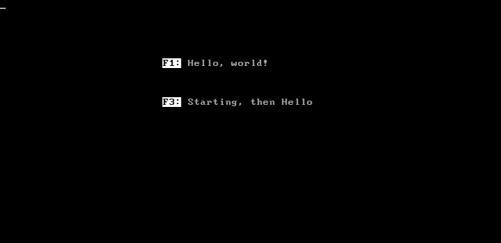

# Destek Option ROM

Reconstructed source, a serial boot host, and runnable examples for the
Destek IBM PC Option ROM. The aim is to make the ROM understandable and
usable again, and to help others test it on original hardware or build
new applications around it.

The reconstructed source assembles to the exact original 8,192 bytes.
The IBM UART boot path runs in an IBM 5150/8088/MDA emulator: it downloads
an application into RAM and executes it without a disk or DOS.
**Real-hardware reports and contributions are welcome.** Physical 5150
and serial-cable operation has not yet been validated.



## Background and original material

Adrian's Digital Basement introduced the recovered PC and investigated its
Destek hardware in these two episodes:

1. [PC Archeology: A left for Dead IBM PC 5150 with a treasure hiding inside](https://www.youtube.com/watch?v=KepvxT6Yc7E)
   (28 October 2023) — the recovered IBM 5150 and the hardware found inside.
2. [PC Archeology: What is this mystery ISA card and how was it used? (Destek)](https://www.youtube.com/watch?v=SR4Wy5KQ1Jc)
   (10 May 2025) — investigation of the Destek ISA network card.

The second episode links to the [Destek 1982 ISA Network Card archive](https://archive.org/details/destek-isa-network-card),
which contains ROM images and disassembly. Related work on GitHub is
[Brian McKelvey's Destek firmware analysis](https://gist.github.com/theturtle32/3a09479b614b65669f4860bd1ba57864),
published as a Gist under `theturtle32`. That analysis explores the Z80 card
firmware and PC Option ROM using OpenAI o3. This repository's independently
checked interpretation and execution evidence are documented in
[ARTIFACTS.md](ARTIFACTS.md) and the [walkthrough](docs/OptionRomWalkthrough.md).

## Try it

The smallest example is [Hello.bin](boot/Hello.bin), a complete 128-byte
application that prints `Hello, world!` using BIOS text services. The
384-byte staged example adds a startup message and an initialization hook.
The downloaded menu offers both examples on F1 and F3.

The Destek network card is not required for a hardware test using the IBM
8250 UART transport. The PC still needs the Destek Option ROM installed
and an IBM-compatible serial port.

For a PC with that configuration,
connect an RS-232 null-modem cable and start the host before the PC boots.
From the `boot` folder, replace COM3 with the host port and match the target
baud rate:

```powershell
powershell -NoProfile -ExecutionPolicy Bypass -File .\Boot-Image.ps1 -Mode Send -Image .\Hello.bin -Port COM3 -BaudRate 9600
```

The [boot package guide](boot/README.md) covers cabling, supported baud
rates, menu selection and replay. Sending the supplied images needs Windows
PowerShell, the serial connection and the `boot` files; it needs no assembler.

The [illustrated walkthrough](docs/OptionRomWalkthrough.md) explains the
execution from BIOS discovery to downloaded code, includes the minimal
workload, and lists the tooling for operation and ROM interpretation.
For emulation, start with [the emulator setup](docs/EmulatorSetup.md).
The walkthrough is also available as [PDF](docs/OptionRomWalkthrough.pdf)
and [printable HTML](docs/OptionRomWalkthrough.html).

## Build and study the ROM

Install the Visual Studio C++ tools with MASM, then run from this directory:

```powershell
powershell -NoProfile -ExecutionPolicy Bypass -File source/Compose-OptionRom.ps1
powershell -NoProfile -ExecutionPolicy Bypass -File testing/rom/Build-OptionRom.ps1
```

The build publishes its output only after every byte matches the original.
The [source guide](source/README.md) explains the maintained fragments.
[ARTIFACTS.md](ARTIFACTS.md) contains the ROM interpretation, recovered
symbols, protocol findings and original artifact provenance.

## What is supported

The demonstrated path uses the original Option ROM with the IBM UART,
an 8088, BIOS text services and MDA. The emulator run uses a locally modified
86Box build; stock 86Box is not interchangeable with that build for this test.
Use the modified emulator only for this Destek test setup, not for other
purposes. Its receive-timing workaround resembles an upstream change that
was reverted and can break other serial workloads; see
[emulator setup](docs/EmulatorSetup.md). It is not
intended for merging into 86Box.
Other adapter transports and the Z80 card firmware remain subjects for further
investigation. See [validation and limitations](boot/Validation.md).

## Help take it further

[CONTRIBUTING.md](CONTRIBUTING.md) explains how to report a hardware run,
extend the examples, improve the ROM interpretation and check changes.
Useful next steps include original-PC serial boot tests, additional adapter
transports, and applications that use the staged initialization hook.

## Repository layout

| Location | Contents |
| --- | --- |
| `boot/` | Standalone serial sender, runnable images, source and protocol guide |
| `source/` | Maintained Option ROM fragments and composition tools |
| `docs/` | Execution walkthrough, screenshots and emulator setup |
| `testing/` | Build checks and reference-emulator support |
| Root ROM files and `ARTIFACTS.md` | Historical inputs, consolidated source and interpretation |

## License

New tooling, examples and documentation are available under the
[MIT License](LICENSE). Historical firmware, reconstructed listings and
third-party material are separately identified in [artifact provenance](PROVENANCE.md).
