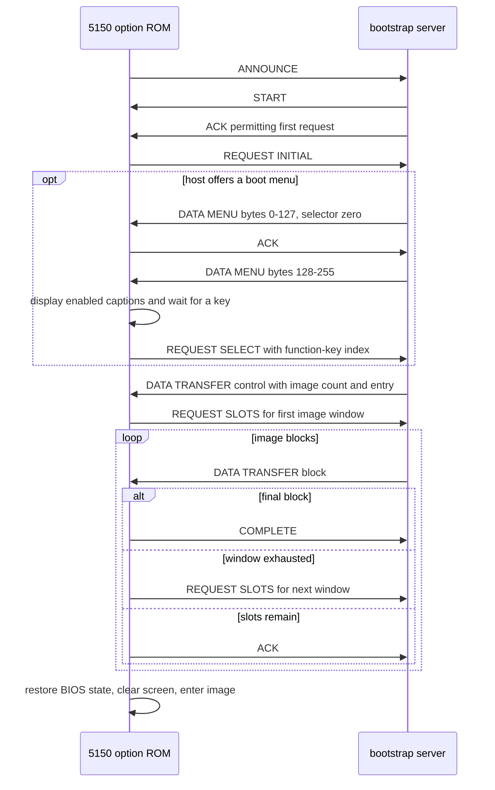

<!-- SerialBootstrapProtocol.md -->

# Serial bootstrap protocol

## Problem

The Destek card provides a ROM-resident communication environment for an IBM
5150 that may have no local mass storage. The option ROM initialises the
machine, selects an available transport, displays status, and runs a repeated
request/response exchange. The received data can ultimately select code in RAM
as the next stage. This note focuses on the standard 8250-compatible COM1 path;
the Destek local-area card uses a different transport protocol.

The ROM announces its presence, expects a framed response with live state,
and delivers validated messages to its session and application processing.
The [boot workflow](README.md) provides the sender and current sample images.

## Layering

ISO/IEC 7498-1 supplies the vocabulary used here [1]. The recovered protocol
has data-link processing (OSI layer 2), a session exchange and state (layer 5),
and application dispatch (layer 7). The ROM does not thereby become a
standards-conformant OSI implementation; the model simply separates the
responsibilities visible in the code.

## Physical layer

The physical layer is the PC COM1 interface built around an 8250-compatible
UART at the fixed I/O base `03f8h`. The ROM probes and assigns that address
directly; it does not read the BIOS data area COM-port table. The ROM selects a
divisor for 9600, 4800, 2400, or 1200 bps and configures asynchronous 8N1
characters with DTR, RTS, and OUT2 asserted. It enables receive,
transmitter-empty, and line-status interrupts on IRQ4.

The UART presents received characters as octets and serialises transmitted
octets. The ROM does not identify the cable, connector, or electrical line
transceiver beyond that COM1 boundary. The following data-link protocol starts
with those UART octets; its sentinels and CRC are not UART settings.

## Data-link protocol

The data-link layer creates frames from UART octets. It recognises sentinels,
decodes escaped content, limits frame size, and verifies the CRC. It delivers a
session message only after those checks succeed.

*Table Data-link frame structure* gives the complete wire structure. The start
and end controls are both two octets, which makes the escape mechanism uniform.
The octet counts describe the decoded frame; quoting can expand payload and CRC
octets on the wire. The session message fields are defined separately in *Table
Session message structure*.

*Table Data-link frame structure*

| Field | Structure | Octets | Description |
| --- | --- | ---: | --- |
| Start control | Control | 2 | Begins a frame and supplies its class |
| Payload | Variable | 0-132 | Delivers the fields in *Table Session message structure* |
| CRC | Checksum | 2 | Verifies the decoded frame; not delivered upward |
| End control | Control | 2 | Terminates the frame; neither octet is delivered upward |

The second octet of the start control is an in-band frame class. It is covered
by CRC and presented with the decoded payload as class metadata. It is not an
octet in the session record and is not duplicated in the payload. *Table
Data-link Start control frame classes* gives the known class meanings.

*Table Data-link Start control frame classes*

| Value | Name | Description |
| --- | --- | --- |
| `f0` | DATA / REQUEST | Client REQUEST carries INITIAL, menu SELECT or SLOTS payloads; host DATA carries MENU, TRANSFER or LOAD payloads |
| `f1` | ACK | Acknowledges session progress; also used by the host to permit a request |
| `f2` | POLL | Requests session progress while waiting |
| `f3` | RETRY | Reports a failed reception and requests recovery |
| `f4` | ANNOUNCE | Initial or restarted client announcement |
| `f5` | START | Establishes session state; an incoming START adopts its address field |
| `f6` | COMPLETE | Client completion notification after the remaining block count reaches zero |

REQUEST is the readable name for client DATA carrying an application request.
It uses the same `aa f0` start control, not an additional wire class.
*Table Client request values* defines its INITIAL, SELECT and SLOTS forms.

There is no length field. The receiver accepts at most 135 stored octets:
one start-type octet, up to 132 payload octets, and two CRC octets. Attempting
to store the 136th octet abandons the frame. This permits 128 image bytes
after accounting for the three session fields and one application dispatch.

*Table Data-link control variants* identifies every meaning of the `aa`
introducer. Framing and escaping share this control mechanism.

*Table Data-link control variants*

| Sequence | Meaning | Description |
| --- | --- | --- |
| `aa f0`-`aa f6` | Start control | Begins a frame and supplies its class |
| `aa fe` | End control | Completes the active frame; neither octet is session data |
| `aa ff` | Quoted data | Delivers one literal data octet `aa` |
| `aa f7`-`aa fd` | Invalid control | Abandons the active frame |
| `aa 00`-`aa a9`, `aa ab`-`aa ef` | Literal pair | Delivers both `aa` and the following octet |
| `aa aa` | Literal followed by introducer | Delivers the first `aa` and retains the second as a pending introducer |

A raw `fe` is session data. It becomes a terminator only in the `aa fe`
sequence. A raw `f0` through `f6` is similarly session data unless it follows
`aa`. A literal `aa` contributes once to CRC; its optional quote selector
does not. The transmitter inserts `ff` only when the octet following a
literal `aa` would otherwise be interpreted as a control (`f0` or above).
Always quoting a literal `aa` as `aa ff` is also accepted by the receiver.

For example, `aa 9b` represents the two literal payload octets `aa` and
`9b`. Only a following control-range octet requires explicit quoting.

The receiver starts its table-driven CRC at zero, processes the start-type
octet, every decoded payload octet, and the two low-byte-first CRC octets,
and accepts only a zero residue. End control is excluded.

The image's table differs from reflected CRC-16 polynomial `a001h` at one
entry: index `a4h` contains `b801h`, whereas the standard recurrence gives
`bb01h`. A standard CRC implementation therefore rejects some intact
messages. Interoperability with this ROM requires its actual table, not
silently correcting it. The test peer now uses that table in both directions.

A transcription typo when the table was copied from a document roughly
40 years ago is a plausible explanation. The bytes and their effect are
confirmed; a single surviving image cannot establish whether the difference
originated in the source, EPROM programming, or later corruption. The
*Bulk download validation* description records the diagnostic evidence.

*Table Data-link error handling* records the detected receive failures and the
observable handling.

*Table Data-link error handling*

| Condition | Detection | Handling |
| --- | --- | --- |
| Data before a start control | No frame is active | Discard the octet |
| Start control during a frame | A new `aa f0`-`aa f6` is received while collection is active | Discard the partial frame and initialise collection for the new frame |
| Bad CRC | End control with a nonzero CRC residue | Discard the completed frame and return to the transport state machine |
| Oversize frame | A 136th decoded octet is attempted | Abandon the frame and return to the transport state machine |
| Invalid control | `aa f7` through `aa fd` | Abandon the active frame |
| End control without a frame | `aa fe` arrives while collection is inactive | Ignore the control sequence |

## Session protocol

The session layer owns the repeated poll/response relationship, the message
class, node identity, and state counters. It receives a decoded message from
the data-link layer and passes the contained application message onward.

*Figure Bootstrap exchange* shows the shared session, including optional
menu selection before image loading. *Table Session message structure*
identifies the contents delivered by each validated frame.

*Table Session message structure*

| Field | Structure | Octets | Description |
| --- | --- | ---: | --- |
| Address or sequence | One octet | 1 | START supplies the assigned address; DATA supplies the record sequence number |
| Local counter | One octet | 1 | Counter checked against current session state |
| Remote counter | One octet | 1 | Counter retained as current peer state |
| Application message | Variable | 0-129 | Contains the payload form selected by the final application dispatch |

DATA processing accepts the next receive sequence before delivering its
application message. A previous-sequence DATA record does not advance
application processing. The client repeats its existing acknowledgement;
the sender can then supply the correct record. The negative test in [3]
verifies this case with a valid CRC and unchanged application payload.

### Retries and timeouts

The session implementation maintains a retry-timeout budget of ten timer
expiries. A validated peer message resets that budget to ten. The PIT-driven
timer decrements it whenever either active response timer expires; expiration
at zero selects the ROM timeout path. The serial configuration loads response
timers with 80 and 40 ticks respectively.

This is session-state recovery, not data-link retry: data-link errors discard
only the affected frame. The timer interrupt supplies the time base, while the
session state machine owns the counters and recovery decisions. The ROM does
not preserve a copy of one completed frame with a separate retransmission
counter, so it does not prove that an identical `START` message is retransmitted
exactly ten times.

## Application protocol

The application layer interprets the message carried after the session header.
It uses the final application octet as a dispatch value and the preceding
octets as application payload.

*Table Application message structure* gives the decoded application structure.
*Table Application payload processing* defines each
payload form and its handling by dispatch.

*Table Application message structure*

| Field | Structure | Octets | Description |
| --- | --- | ---: | --- |
| Application payload | Variable | 0-128 | Data consumed by the selected application operation |
| Application dispatch | One octet | 1 | Selects the application operation |

The application payload is every application octet before the final dispatch
octet. It follows the three session fields. The receiver copies it to an
allocated descriptor before it examines the final dispatch octet.

*Table Application payload processing* defines the payload and processing of
every recovered application dispatch.

*Table Application payload processing*

| Dispatch | Name | Payload structure | Payload octets | Processing |
| --- | --- | --- | ---: | --- |
| `00` | CHECK SERVER | None identified | 0 | Discard the completed record, display the fixed message, and reset |
| `0c` | TRANSFER control | Little-endian block count, then little-endian continuation offset | 4 | In the initial phase, store the nonzero count and entry offset, then request image blocks |
| `0c` | TRANSFER block | Image bytes | 0-128 | In the image phase, retain the copied block, decrement the count, and advance the slot; when the count reaches zero, notify completion and hand off |
| `0c` | MENU block | One half of a 256-byte menu | 128 | In the initial phase, a zero first word selects menu loading; the second block makes the menu available for selection |
| `0d` | LOAD | Image bytes | 0-128 | Retain the copied bytes without advancing the slot, then return to the session exchange |
| Other nonzero | DUPLICATE ADDR | Not interpreted | 0 | Discard the completed record, display the fixed message, and reset |

The initial phase distinguishes a nonzero image-block count from a zero
menu selector. The menu path uses two full 128-byte records, not a separate
four-byte control followed by two menu records.

The TRANSFER target is control flow rather than the receive-buffer address.
The receive allocator chooses the latter before dispatch processing.

### Downloaded boot menu

The host supplies all menu-item text. The ROM supplies only the F1-F8
prefixes, positions and display attributes. *Table Menu payload structure*
describes the concatenation of the two application payloads, excluding
their separate dispatch octets. The first record advances to the second
introductory slot; the second record opens the menu.

*Table Menu payload structure*

| Field | Structure | Octets | Description |
| --- | --- | ---: | --- |
| Menu selector | Little-endian word | 2 | Selects menu loading |
| Item masks | Eight octets | 8 | F1 through F8; an item is enabled when its mask intersects the client's advertised mask |
| Captions | Eight 30-octet fields | 240 | F1 through F8 text; enabled captions are space-padded without terminators; disabled captions are ignored |
| Unused tail | Six octets | 6 | Not read by the menu writer; the sample sends zeroes |

*Table Menu field values* specifies values separately from the structure.
Missing or disabled keys do not produce a selection request. Both key make
and break codes pass through the ROM's scan-code filter.

*Table Menu field values*

| Field | Value | Meaning |
| --- | --- | --- |
| Menu selector | 0000h | Two-record menu, rather than a counted image |
| Item mask | 00h | Disabled item |
| Sample enabled-item mask | 01h | Enabled with the tested client's ffh mask |
| Caption padding | 20h | Fill each caption to exactly 30 octets |

### Client application requests

The client uses DATA with application dispatch 0ch for requests as well as
the host using it for responses. *Table Client request payload structure*
defines its four application payload octets. Session fields and dispatch
remain outside this payload, as defined above.

*Table Client request payload structure*

| Field | Structure | Octets | Description |
| --- | --- | ---: | --- |
| Request | Little-endian word | 2 | Initial request, menu selection, or first requested image slot |
| Argument | Little-endian word | 2 | Availability mask and selection, or last requested image slot |

*Table Client request values* distinguishes the three forms. Image slot
ranges are inclusive. A selection restarts the image allocator at slot zero
without restarting the link or resetting the session sequence numbers.

*Table Client request values*

| Request | Argument | Meaning |
| --- | --- | --- |
| 8001h | Low byte: client mask; high byte: initial zero | Request an image or a menu |
| 8002h | Low byte: retained client mask; high byte: zero-based function-key index | Request the selected boot image |
| Nonnegative slot index | Last slot index | Request the next window of image blocks |

For the sample, the initial payload is `01 80 ff 00`. F1 produces
`02 80 ff 00`; F3 produces `02 80 ff 02`. Each is followed by dispatch
`0c`. The selection value is an index, not the caption or a filename.
The server maps it to a configured image.

*Figure Bootstrap exchange* includes the menu as an optional prefix to the
common image download, following the initial request.
The host answers selection with the usual nonzero block count and entry
offset, then serves the requested image windows. In the tested exchange,
menu records use receive sequences 00h and 01h, the selected-image control
uses 02h, and image data begins at 03h. The captions are overwritten when
the selected image loads into the same introductory area.

*Figure Bootstrap exchange*

MENU, INITIAL and SELECT name application payload forms, not additional
link classes. All three travel in DATA with dispatch 0ch. Repeated requests
and timeout POLLs can also occur while frames are in flight.

The distributed bootstrap preamble and application follow
the image contract [2]. Their execution begins after the protocol has
delivered the complete image and selected its continuation.

## Demonstration

### Interactive emulator menu

*Listing Run interactive menu* starts the host and the configured 86Box
IBM 5150 from the repository root. It continues the emulator automatically
and leaves the function-key choice to the user; it does not run the
automated key-selection test. Emulator setup is described in [3].

*Listing Run interactive menu*

`powershell -NoProfile -ExecutionPolicy Bypass -File testing/boot/Start-86Box.ps1 -Menu boot/Menu.json -TimeoutSeconds 600`

Click the emulator window after the downloaded menu appears. F1 selects
the standalone Hello image; F3 selects the combined bootstrap and Hello
image. F2 and F4-F8 are disabled in Menu.json. The 600-second limit belongs
to the test launcher and host, not to the protocol's timer fields.

Selection returns to the saved loading display while the host sends the
chosen image. At completion the ROM clears the screen and transfers control.
F1 displays Hello, world! without a banner. F3 first displays Starting ...,
then Hello, world! The source mappings are documented in ARTIFACTS.md in
the repository; the session and payload formats are specified above.

### Initial client message

The START message contains no application payload: it is session control, so
there is neither an application operation nor data for the application layer to
interpret. Its formal form is `START <ADDR> <LOCAL> <REMOTE>`.

In the emulator capture the client first announces with session fields
`00 ff 0a`. The host replies with START fields `00 00 ff`. An incoming START
adopts the received address field; the example does not assume this value
must equal the programmed ROM node address.

The initial client announcement is built from the inside out:

1. The session layer message is `ANNOUNCE 00 ff 0a`, with no application
   payload.
2. The data-link layer emits the ANNOUNCE control and the session record,
   calculates CRC `c7f3h` over the type and session record, and encloses the
   message as `aa f4 00 ff 0a f3 c7 aa fe`.

This is the captured first transmission. Later messages require the current
counters and the ROM-specific CRC calculation.

The demonstration follows *Figure Bootstrap exchange*, with or without
its optional menu block. The TRANSFER control has four payload octets;
subsequent TRANSFER blocks carry image bytes.

After COMPLETE finishes transmitting, the option ROM restores its
BIOS-facing state and clears the display before transferring control.
The downloaded Bootstrap.bin then prints Starting at the former Loading
position. It does not clear the screen itself. The standalone Hello.bin
has no Starting banner.

## Validation

Emulator tests verified retention of 162 full blocks, covering the 256-byte
introduction and 20 KiB of bulk data, and execution of both supplied Hello
images. The distribution includes [Hello.trace.log](Hello.trace.log) and
[HelloStaged.trace.log](HelloStaged.trace.log), whose DATA payloads match
the corresponding binaries byte for byte. Test configurations, debugger
captures and other replay fixtures remain under `testing/boot`.
The current platform is 86Box's IBM 5150 model with an 8088, MDA and an
8250 UART. The unchanged ROM boots through the original IBM BIOS and
executes both supplied Hello images. A deliberate previous-sequence DATA
response is rejected; the corrected response completes the download without
an extra application record. The emulator configuration, compatibility
adjustments and validation limits are described in [3]. Physical 5150
and physical serial-link validation remain outstanding.

Menu tests verified all caption bytes and MDA output, rejection of disabled
F2, and successful F1 and F3 selections. Each selected image matched in
memory and executed through its completion loop. The retained exchanges
are [MenuF1.trace.log](MenuF1.trace.log) and
[MenuF3.trace.log](MenuF3.trace.log). The source also now assembles to a
bit-identical copy of the original 8,192-byte ROM.

## References

1. Information technology -- Open Systems Interconnection -- Basic Reference
   Model: The Basic Model (ISO/IEC 7498-1),
   https://www.iso.org/standard/20269.html, International Organization for
   Standardization, 1994-11.
2. Bootstrap distribution (Image contract), BootstrapDistribution.md,
   Destek ROM analysis, 2026-09-09.
3. [Emulator validation](Validation.md) (86Box boot and compatibility),
   Destek ROM analysis, 10 September 2026.
