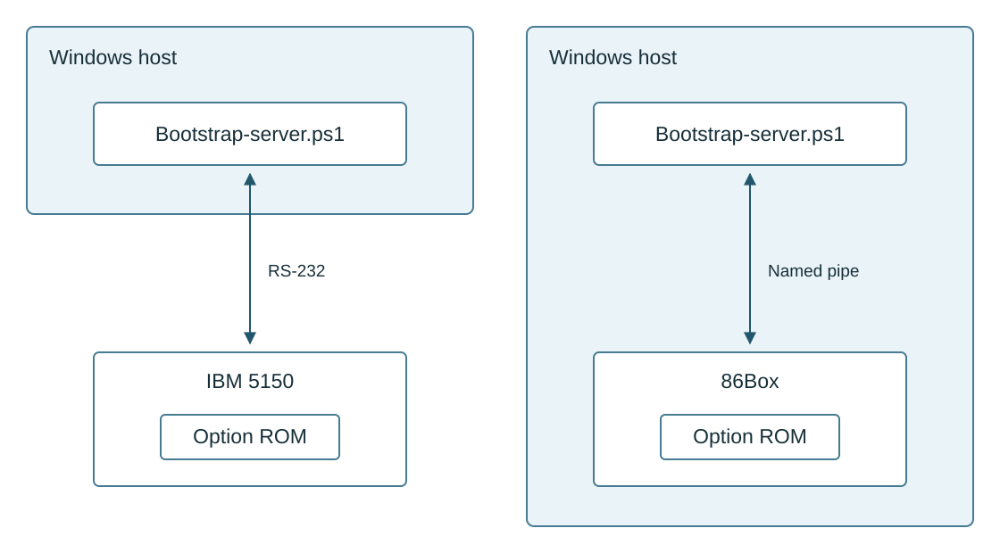
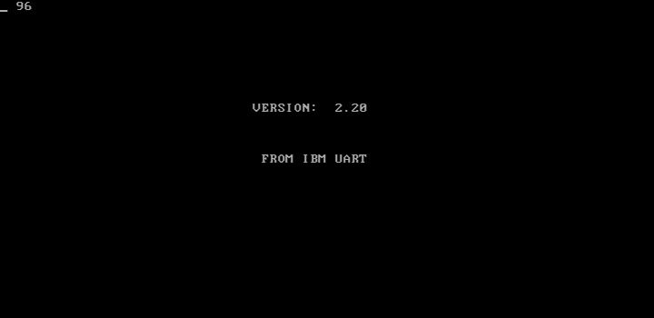
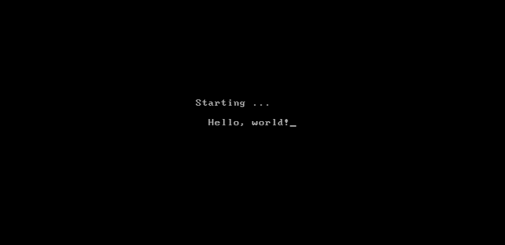

# Destek Option ROM execution walkthrough

The Destek Option ROM can boot an IBM PC into an application downloaded over
serial, without a disk or DOS. This walkthrough follows the unchanged ROM
from BIOS discovery through transport setup, download and application entry.
It includes the complete 128-byte Hello workload and the optional downloaded
menu and staged startup.

The screenshots show an IBM 5150 with an 8088 and MDA in the modified 86Box
reference emulator. The ROM rebuild matches all 8,192 original bytes; debugger
checks verify downloaded memory and application output. Physical PC and
serial-cable testing is still needed, and hardware reports are welcome.

## What you can run

*Table 1* lists the supplied applications and downloaded menu.

*Table 1 Example applications*

| Example | Size | Result |
| --- | ---: | --- |
| Hello.bin | 128 bytes | Downloads and executes `Hello, world!` through BIOS text services |
| HelloStaged.bin | 384 bytes | Runs a startup preamble and initialization hook, then the same Hello body |
| Menu.json | Two menu records before the selected image | Offers F1 for Hello and F3 for staged Hello; F2 is disabled |

The validated path uses the IBM UART. Other transports probed by the ROM
and the Z80 card firmware remain areas for further work. A larger diagnostic
transfer has also verified 256 introductory bytes and 20,480 bulk bytes;
that diagnostic data is not an executable application. See
[validation and limitations](../boot/Validation.md).

## Communication arrangements

*Figure 1* shows the same bootstrap arrangement in two forms: a physical IBM 5150 on the left and an emulated PC on the right. Read each connection from the Windows host at the top to the target PC below it. The arrows carry traffic in both directions. The boxes indicate where code runs: `Bootstrap-server.ps1` runs under Windows PowerShell, while the Option ROM runs on the target PC's processor. The server emulates the remote bootstrap service; **86Box** emulates the PC itself.



*Figure 1 Bootstrap connections*

On the left of *Figure 1*, the Windows host and IBM 5150 are separate machines. The 5150 must have the Destek Option ROM installed in its adapter-ROM address space and an IBM-compatible UART. During POST, BIOS discovers the ROM and calls its initialization entry. The ROM then selects a transport and performs the bootstrap exchange. The downloaded application executes in the 5150's RAM, using its processor and BIOS display services; neither DOS nor a boot disk is needed.

The Destek network card is not required for this hardware test: the IBM 8250 UART transport uses a standard IBM-compatible serial port. The Destek Option ROM must still be installed so BIOS can discover and execute it. This tests the ROM's serial bootstrap path; it does not exercise the Destek card or its Z80 firmware.

The physical connection is an RS-232 null-modem cable between the Windows host's serial port or RS-232 adapter and the target UART. `Bootstrap-server.ps1` accesses the host port through .NET `SerialPort`. Both ends must use the same supported baud rate: 1200, 2400, 4800 or 9600 bps. The sender uses eight data bits, no parity, one stop bit and no hardware flow control, with DTR and RTS asserted. The reference target uses COM1 at `03f8h`, IRQ4 and 9600 bps. This physical arrangement is available for others to try, but has not yet been validated on hardware.

On the right of *Figure 1*, both the server and 86Box run inside one Windows host. The 86Box box represents the complete guest PC: an IBM 5150 with an 8088 at 4.77 MHz, 512 KiB RAM, MDA display and an 8250 UART. The original 8 KiB Destek Option ROM is mapped at physical `c8000h` inside that guest. The guest's BIOS discovers and executes it in the same way as an installed adapter ROM. The ROM and downloaded application execute as 8088 instructions within 86Box; PowerShell supplies the remote end of their serial protocol.

The named-pipe arrow in *Figure 1* connects the server directly to 86Box's emulated COM1. The server creates the Windows pipe `destek-86box`, and 86Box attaches its serial backend to it. Bytes written by the server become input to the emulated UART; bytes transmitted by the guest UART return through the pipe to the server. This local connection needs no physical cable or host serial adapter. It exercises the ROM's IBM UART path, including the guest's UART registers and interrupts.

In both arrangements, `Boot-Image.ps1` is the command-line entry point for selecting an image or menu and starting `Bootstrap-server.ps1`. The PC initiates discovery with ANNOUNCE; the server answers with START and ACK. The ROM requests menu or image records, and the server supplies the control record and requested 128-byte blocks. A downloaded menu lets the user select an image before that image is transferred. The ROM checks and places the received bytes, sends COMPLETE, restores BIOS state and jumps to the application's entry address. COMPLETE acknowledges the transfer; the application's display or a debugger check establishes that execution followed.

For the emulated arrangement, `Start-86Box.ps1` starts the PowerShell server, waits for its pipe, starts 86Box and manages GDB. GDB can resume the machine or stop at ROM and application entry points to inspect registers, downloaded RAM and display memory. Its loopback debugger connection is separate from the bootstrap connection drawn in *Figure 1*. The [emulator setup](EmulatorSetup.md) gives the build, machine-ROM and launch instructions.

The PC emulator itself has a local receive-timing workaround for the Destek named-pipe test. In the unpatched 86Box build, the UART receive timer reads one pipe byte per bit period, allowing incoming data to overrun the emulated 8250 before the guest services it. [SerialReceiveTiming.patch](../testing/boot/86box/SerialReceiveTiming.patch) changes both receive-timer scheduling sites to use a complete character interval. The patched timer delivers one character per configured character interval: at 9600 bps with 8N1, ten bit periods take about 1.04 ms of emulated time. No separate bridge process is required. The local emulator patches also correct transmit-empty interrupt behavior so the ROM can finish transmitting COMPLETE and enter the application. These local changes leave the Destek ROM unchanged. The launcher keeps the server's pipe attached after COMPLETE while the application runs, then closes it during shutdown; the physical serial sender exits on COMPLETE.

**Use this modified 86Box build only for the documented Destek test setup; it should not be used for other purposes.** Its receive-timing workaround is similar to upstream attempt [3fd3907](https://github.com/86Box/86Box/commit/3fd3907848808e6b2aba35aa5b6c27713e75a0f8), reverted by [d4623f9](https://github.com/86Box/86Box/commit/d4623f95b66504f7af169c87dc2b6f01206ad9d1) after Windows 9x modem detection failed. Slowing the whole receive callback also delays internal receive processing needed by timing-sensitive devices and drivers, including serial-mouse cases identified upstream. Our patch does not decouple these operations and is not a more general solution. It is not intended for merging into 86Box; no upstream submission or further emulator change is planned.

The screenshots and memory checks in this walkthrough validate the right-hand arrangement in *Figure 1*. Other recovered transport paths are listed in *Table 2*; they are not exercised by either demonstrated server connection. Server traces preserve the exchanged bytes for inspection and replay, as illustrated below.

## Frame logging

The server records raw bytes and decoded frames so exchanges can be inspected and replayed. Directions are relative to the server. *Fragment 1* shows the first five and last five entries of the small Hello example, with the centre omitted. The opening entries identify the image and connection; the closing entries show the ROM's COMPLETE frame and the acknowledged transfer. Use the [complete Hello trace](../boot/Hello.trace.log) for replay; the excerpt is abbreviated. See the [channel trace format](../boot/ChannelTrace.md).

*Fragment 1 Hello trace*

```text
2026-09-10T03:51:45.4083651+02:00	Comment 	Hello.trace.log - Verified download of Hello.bin; wire directions are relative to the host.
2026-09-10T03:51:45.4161187+02:00	Comment 	Server mode Slots; wire directions are relative to the host.
2026-09-10T03:51:45.4171270+02:00	Comment 	CRC uses the extracted ROM table (entry a4=b801); decoder accepts conditional aa quoting.
2026-09-10T03:51:45.4221302+02:00	Comment 	Image C:\Users\Pekka\Source\repos\destek\boot\Hello.bin; 1 blocks of 128 bytes; completion requested: True.
2026-09-10T03:51:45.4231268+02:00	Status  	Waiting for emulator named-pipe client 'destek-bootstrap'.
...
2026-09-10T03:52:31.5099342+02:00	Receive 	F6
2026-09-10T03:52:31.5129279+02:00	Receive 	01 01 0C 63 DD AA
2026-09-10T03:52:31.5174876+02:00	Receive 	FE
2026-09-10T03:52:31.5215137+02:00	Received	COMPLETE 01 01 0C [DD63]
2026-09-10T03:52:31.5235091+02:00	Complete	Image transfer acknowledged by client.
```

## Available transports

The ROM probes the transports in the order shown in *Table 2*. These are paths
present in the recovered firmware; only the IBM UART path has execution
validation in the reference emulator. The PowerShell sender implements that
serial path. Availability in the ROM does not establish support by the host
script or by the emulator for the other adapters.

*Table 2 Transport paths*

| Probe order | Transport | ROM interface | Test status |
| --- | --- | --- | --- |
| 1 | Local-area adapter, associated with the Destek Z80 card | Reset at 0220h; status/data pair at 036eh/036fh | Not tested end to end |
| 2 | Tigan LAN | Adapter register and RAM interface; status/command at 031eh/031fh | Not tested end to end |
| 3 | IBM PC-NET | Binds the resident service through interrupt vector 5Ch, with entry cc00:0003 | Not tested end to end |
| 4 | Eagle USART | Serial adapter registers at 0300h, 0302h and 0304h | Not tested end to end |
| 5 | IBM UART | COM1 8250 at 03f8h, IRQ4 in the reference machine | Tested in 86Box; physical hardware untested |

[SelectTransport](../source/5150%20Option%20ROM.asm), the
[adapter definitions](../source/OptionRomAdapterHardware.inc) and
[artifact interpretation](../ARTIFACTS.md) identify these paths. The local-area
adapter, Tigan LAN and IBM PC-NET are separate firmware implementations.

## Required support tooling

*Table 3* separates the tools for operation, emulation and ROM interpretation. The supplied boot binaries can be sent without installing an assembler or disassembler.

*Table 3 Support tooling*

| Task | Required tools and inputs | Purpose and constraints |
| --- | --- | --- |
| Send the supplied workload to hardware | Windows PowerShell 5.1 (`powershell.exe`), .NET `System.IO.Ports.SerialPort`, a host RS-232 port or adapter, null-modem cable, and the four files listed below | Runs the sender at 8N1 with no hardware flow control; DTR and RTS are asserted. A TTL UART adapter is not an RS-232 connection. |
| Receive on the target | Compatible PC with this Option ROM installed, BIOS display services, RAM for the fixed workspace, and IBM-compatible UART | The demonstrated configuration is IBM 5150, 8088 at 4.77 MHz, MDA, COM1 at `03f8h`/IRQ4, 512 KiB RAM. Analysis requires at least 128 KiB; that smaller configuration has not been tested. |
| Compose the staged image | Windows CMD and supplied `hello.bat`, `Bootstrap.bin`, `Hello.bin` | `copy /b` creates the 384-byte staged image; no assembler is needed. |
| Run the reference emulator | Locally modified 86Box 6.0 build 9001, IBM 5150 BIOS/BASIC and MDA font ROMs, `86box.cfg`, PowerShell launcher and sender | Maps the unchanged 8 KiB ROM at physical `c8000h`. The UART receive timer paces complete characters internally. These are emulator dependencies, not hardware sender dependencies. |
| Trace execution and verify RAM | GDB 17.1 with Python support, modified 86Box built with `GDBSTUB=ON`, `DYNAREC=OFF`, supplied `.gdb` scripts | Uses loopback port 12345, physical hardware breakpoints and memory reads. No separate Python installation is needed for GDB's embedded Python. |
| Capture execution screens | Windows desktop session, PowerShell, .NET System.Drawing, User32, `Capture-Window.ps1` | Presents the emulator without taking focus so SDL renders, then saves window PNGs alongside debugger evidence. |
| Rebuild the ROM or Hello | Microsoft MASM `ml.exe`, tested version 14.42.34438.0; PowerShell build scripts | Visual Studio C++ tools supply MASM. `vswhere.exe` discovers it, or pass `-Assembler` explicitly. OMF bytes and fixups are extracted by the scripts; no linker is required. |
| Maintain the reconstructed listing | PowerShell, `source/Compose-OptionRom.ps1`, `Format-Assembly.ps1`, source fragments | Compose the canonical include tree, enforce layout, then rebuild and compare with the original.  |
| Inspect instruction encodings | GNU objdump 2.46; annotated `.asm`, `.sym`, and original binary | Disassembles raw bytes in 8086 Intel syntax; useful for checking an interpretation against actual instructions. |
| Browse recovered symbols interactively | Optional radare2 plus `5150 Option ROM.r2` | Loads the supplied names and function overlay. A tested radare2 version is not recorded; it is not needed for the build or demo. |
| Verify identity and protocol records | PowerShell `Get-FileHash`, ROM comparison, CRC export and trace/replay tests | Confirms input identity, original CRC-table behavior, exact trace matching and failure handling. |
| Rebuild the modified emulator | Git, CMake, Ninja, MinGW GCC/G++ 15.2.0, SDL2, libpng, FreeType, libsndfile, libslirp, libserialport | Use 86Box v6.0 commit `4fef696a4eead1d55a28d6ac0e5bd2864e5454da`, the supplied `LocalFixes.patch`, `SerialReceiveTiming.patch` and `Build-Debugger.ps1`. Pass -Mingw and -CMake to select other tool installations. |

The [emulator setup guide](EmulatorSetup.md) and [emulator build script](../testing/boot/86box/Build-Debugger.ps1) specify the environment. The local emulator patches change transmit-empty interrupt behavior and apply the local receive-timing workaround, and limit the debugger to loopback. The stock build previously reached COMPLETE but stalled before application entry.

## The minimal workload

Copy these files together from `boot`: [Hello.bin](../boot/Hello.bin), [Boot-Image.ps1](../boot/Boot-Image.ps1), [Bootstrap-server.ps1](../boot/Bootstrap-server.ps1), and [RomCrc16.txt](../boot/RomCrc16.txt). The full `boot` folder also contains instructions, menu configuration, staged binaries and reference traces.

Start the host before booting the target. From the copied folder, replace COM3 with the actual host port and configure both ends for 9600 bps:

*Fragment 2 Send Hello*

```powershell
powershell -NoProfile -ExecutionPolicy Bypass -File .\Boot-Image.ps1 -Mode Send -Image .\Hello.bin -Port COM3 -BaudRate 9600
```

Supported rates are 1200, 2400, 4800 and 9600 bps. The sender records `bootstrap-wire.log` and exits when it receives COMPLETE. **COMPLETE confirms the transfer; the displayed Hello and debugger entry establish that the application ran.**

`Hello.bin` contains the entry jump, executable body, zero-terminated message and padding in one 128-byte block. The host sends `{01 00 00 7C}` separately as the little-endian block count and entry offset. The ROM loads the block at physical `08000h` and enters `0040:7c00`, which addresses that same byte.

The first five bytes, `EA 05 00 00 08`, jump to `0800:0005`. The body sets DS to CS, clears the direction flag, and writes each character through BIOS `INT 10h`, function `0Eh`. It finishes in an interrupt-disabled loop at `0800:001e`. It uses the stack restored by the ROM and needs neither DOS nor a graphics driver. This is a complete boot/application demonstration, with no command prompt or return to DOS. Reset the target to run it again.

*Fragment 3* reproduces the executable body from [Hello.asm](../boot/Hello.asm); that file also contains the MASM segments, standalone far jump and 128-byte extent.

*Fragment 3 Hello application*

```asm
Hello:
                push    cs
                pop     ds
                cld
                mov     si,offset HelloText
                xor     bx,bx
                mov     bl,07h
                jmp     short Hello2
Hello1:
                mov     ah,0eh
                push    si
                push    bx
                int     10h
                pop     bx
                pop     si
Hello2:
                lodsb
                or      al,al
                jnz     Hello1
Hello3:
                cli
                jmp     short Hello3
HelloText       db      'Hello, world!',0
```

## Execution walkthrough

Steps 1 through 5 follow the direct Hello download. Step 6 describes the optional menu and staged application.

1. **BIOS discovers the ROM**

   The 5150 BIOS performs POST and scans the adapter-ROM area. The image begins `55 AA 10`: the signature and a length of sixteen 512-byte units. BIOS enters `c800:0003`; the header jumps to the ROM initialization code at offset `0049h`. No floppy launcher is involved.

   There is no distinct ROM message yet. The debugger records CS=`c800h`, physical EIP=`c8003h`, and caller SS:SP=`0030:00f6`; the first useful display follows initialization.


2. **The ROM establishes its environment**

   `OptionRomEntry` saves the caller's SS:SP, installs a temporary stack at `1fe0:0100`, initializes display, interrupts and timer, and copies its runtime template into the workspace at physical `1fa00h`. It displays version 2.20 and the loading message. `SelectTransport` probes the supported adapters; this machine reaches the IBM UART path.

   *Figure 2* shows version 2.20 and `FROM IBM UART`, which identifies the selected transport. The top-left `96` represents 9600 bit/s. The capture stops at the IBM UART interrupt handler at physical `c85ceh` during the early exchange.

   

   *Figure 2 ROM initialization*

   The temporary PIC vector base is `20h` with automatic end-of-interrupt. IRQ4 services serial traffic; timer IRQ0 supplies timeout ticks. [Entry source](../source/OptionRomEntryFragment.inc) and [the ROM listing](../5150%20Option%20ROM.asm) connect these operations to the recovered code.


3. **The host and ROM exchange the image**

   The client announces itself; the host establishes the session. *Table 4* gives the minimal exchange. Retransmitted requests can appear in the actual trace while the paced emulator connection catches up.

   *Table 4 Minimal download exchange*

   | Direction | Record | Effect |
   | --- | --- | --- |
   | ROM to host | ANNOUNCE | Begins discovery |
   | Host to ROM | START, ACK | Establishes the session |
   | ROM to host | INITIAL request | Requests the initial application record |
   | Host to ROM | TRANSFER `{01 00 00 7C}` | Specifies one block and entry offset `7c00h` |
   | ROM to host | SLOTS `0000..0000` | Requests block zero |
   | Host to ROM | TRANSFER with all 128 Hello bytes | Loads physical `08000h..0807fh` |
   | ROM to host | COMPLETE | Acknowledges transfer completion |

   *Figure 3* shows the progress character during the download. The initial space (`20h`) advances once for the control record and once for the image block. At the transfer wait, all 128 downloaded RAM bytes match Hello.bin. The rendered frame still shows `!`, while the debugger verifies `"` (`22h`) in display memory: screen refresh can lag a debugger stop. The character is a record counter, not a percentage.

   

   *Figure 3 Download progress*

   The protocol uses the original ROM CRC table, including entry `a4h = b801h`. A generic replacement CRC table would change compatibility. See the [protocol specification](../boot/SerialBootstrapProtocol.md) for the exact record layout.


4. **The ROM restores BIOS state and enters RAM**

   After transmitting COMPLETE, the ROM waits for transmit completion. `RestoreBiosAndTransferControl` restores BIOS-facing PIC and timer state, clears/reinitializes the display, restores the original stack, and performs the far jump through `TransportContinuation`.

   *Table 5* identifies the handoff and application entry points.

   *Table 5 Execution entry points*

   | Breakpoint | Observed execution state |
   | --- | --- |
   | `c800:0934` | Final far jump; SS:SP restored to `0030:00f6` |
   | `0040:7c00` | Downloaded entry, physical `08000h` |
   | `0800:001e` | Hello completion loop after normalizing CS and printing |

   The debugger checks these transitions during the walkthrough test. GDB's 86Box interface reports EIP as a physical address; use CS and the physical address together when interpreting its register output. The screen clears between the ROM loading display and application output.


5. **The downloaded application runs**

   *Figure 4* shows `Hello, world!` printed by the downloaded application. The debugger independently verifies that text and attribute `07h` in MDA memory, as well as the downloaded bytes.

   

   *Figure 4 Hello output*

   This small workload demonstrates the entire working chain: ROM discovery, serial protocol, block placement, restoration, control transfer and BIOS text output.


6. **Optional downloaded menu and staged startup**

   The host can supply two menu records before the image. From `boot`, run:

   *Fragment 4 Serve the boot menu*

   ```powershell
   powershell -NoProfile -ExecutionPolicy Bypass -File .\Boot-Image.ps1 -Mode Send -Menu .\Menu.json -Port COM3 -BaudRate 9600
   ```

   *Figure 5* shows the downloaded boot choices: F1 enables Hello and F3 enables staged Hello. F2 is disabled; the test confirms that pressing it returns to keyboard polling, then selects F3 through the normal keyboard path.

   

   *Figure 5 Boot menu*

   The 384-byte `HelloStaged.bin` is `Bootstrap.bin` followed by the unchanged `Hello.bin`. Its first two blocks occupy `08000h..080ffh`; the Hello block occupies `00500h..0057fh`. Startup prints `Starting ...`, calls the empty Initialise subroutine, and jumps to `0050:0005`, skipping Hello's standalone entry jump.

   *Figure 6* shows the result of F3: the startup preamble prints `Starting ...`, then the unchanged Hello body prints its message. The debugger verifies all 384 downloaded bytes and both output strings.

   

   *Figure 6 Staged startup*

   This arrangement provides a place for application-specific initialization before a larger payload. Images must contain 1 through 248 complete 128-byte blocks; the host enforces the limit to prevent bulk data overwriting the introduction. See the [boot memory map](../boot/BootMemoryMap.md).

## Run and inspect the ROM

Follow the [emulator setup](EmulatorSetup.md), then run these examples from the project root. The first leaves Hello visible for inspection; the second checks menu selection and staged execution automatically. Run them sequentially because the emulator uses fixed pipe names and debugger port 12345.

*Fragment 5 Run the emulator*

```powershell
powershell -NoProfile -ExecutionPolicy Bypass -File testing/boot/Start-86Box.ps1
powershell -NoProfile -ExecutionPolicy Bypass -File testing/boot/Start-86Box.ps1 -Image boot/HelloStaged.bin -Menu boot/Menu.json -MenuKey 3 -GdbScript testing/boot/86box/Inspect-Menu.gdb
```

For interactive debugging, launch with `-WaitDebugger` and attach GDB to `127.0.0.1:12345` using `set architecture i8086`. Hardware breakpoints such as `hbreak *0xc8003` stop at ROM entry without inserting bytes into the ROM. The supplied `.gdb` scripts provide further examples of register inspection and independent memory comparisons.

To regenerate and verify the ROM:

*Fragment 6 Rebuild the ROM*

```powershell
powershell -NoProfile -ExecutionPolicy Bypass -File source/Compose-OptionRom.ps1
powershell -NoProfile -ExecutionPolicy Bypass -File testing/rom/Build-OptionRom.ps1
Get-FileHash '.\5150 Option ROM.bin' -Algorithm SHA256
```

Expected SHA256: `BB1AD6A65F5911F8EFBEC8FD6CC916495ADC1C024FB036B7AEBE3F0287311666`. The build fails if any byte differs. MASM warning A4013 is expected for initialized data in the absolute segment; the build extracts and verifies the emitted OMF data.

For static interpretation, read [ARTIFACTS.md](../ARTIFACTS.md), [the workspace map](../OptionRomMemoryMap.md), the fragments in `source`, and the canonical `.sym` file alongside the actual bytes. Objdump is required for the first command below; radare2 is optional for the second:

*Fragment 7 Inspect ROM instructions*

```powershell
& C:/msys64/mingw64/bin/objdump.exe -D -b binary -m i8086 -M intel --start-address=0x49 --stop-address=0xe8 '5150 Option ROM.bin'
r2 -a x86 -b 16 -m 0xc000 -i '5150 Option ROM.r2' '5150 Option ROM.bin'
```

**Keep address conventions separate.** Objdump without an adjusted base shows file offsets. The `.sym`/radare2 overlay uses file offset plus `c000h`. The demonstrated runtime mapping uses file offset plus `c8000h`: symbolic `C049` therefore corresponds to file offset `0049h`, segment address `c800:0049`, and physical breakpoint `c8049h`. MASM `assume` directives describe register assumptions; they do not set registers at runtime. Linear disassembly may interpret tables as instructions, so source labels and dynamic evidence must support any claimed execution path.

## Try hardware or extend the application

The serial boot package can be used independently of the emulator. Start
with the direct Hello download, then test both enabled menu choices. A useful
hardware report identifies the PC, ROM mapping, UART, cable, baud rate and
image checksum, and includes the host trace and visible application output.
COMPLETE alone confirms the download, not application execution.

The staged preamble provides an initialization hook for a larger application.
The recovered source and symbol overlay also provide starting points for
investigating other adapter transports. See [CONTRIBUTING.md](../CONTRIBUTING.md)
for hardware reports, application development and interpretation changes.
